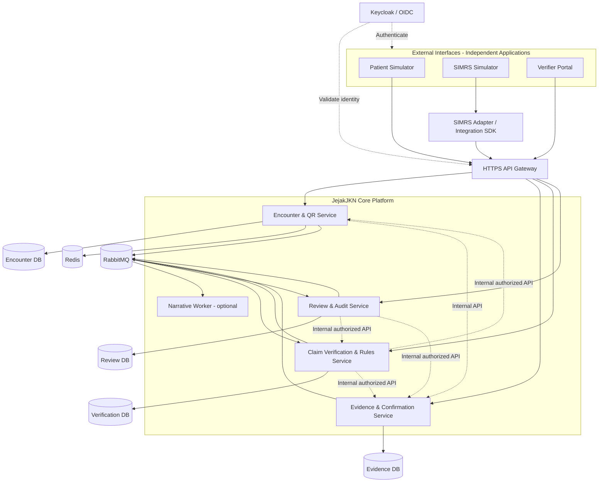
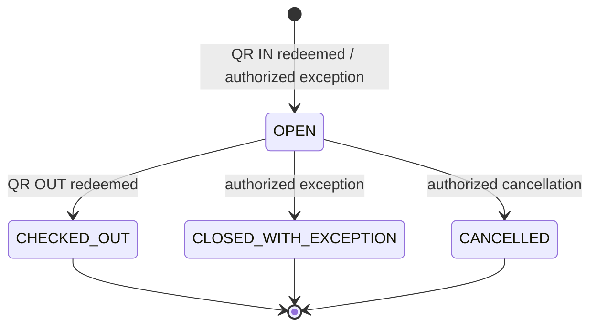
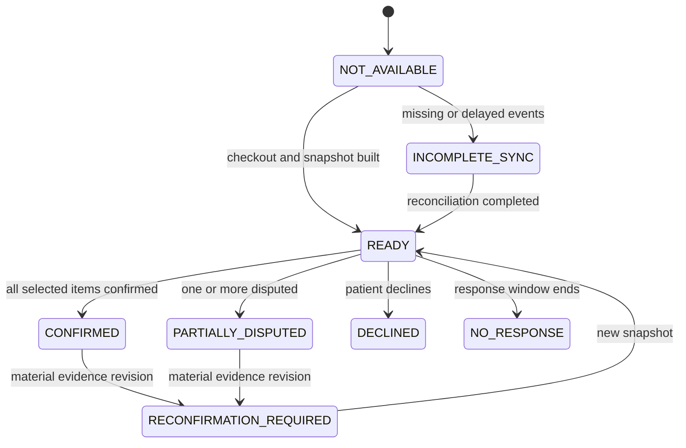

# JejakJKN — Full Technical Implementation Specification

**Versi:** 1.0 (20 Oktober 2026)  
**Basis rancangan:** *JejakJKN — Arsitektur Aplikasi v1.2* dan keputusan desain pada diskusi proyek  
**Status:** *Implementation blueprint* untuk pengembangan dengan data sintetis. **Bukan** spesifikasi resmi integrasi BPJS/SATUSEHAT/SIMRS produksi.  
**Audiens:** Software engineer, system architect, DevOps engineer, QA engineer, dan coding agent.  
**Bahasa implementasi:** Python dan TypeScript; contoh konfigurasi/kontrak dalam SQL, JSON, YAML, dan pseudocode.

> **Kontrak utama:** JejakJKN menyimpan data kunjungan dan pelayanan yang **diterima** dari SIMRS melalui API; pasien hanya memindai QR masuk/keluar dan mengonfirmasi ringkasan **setelah QR keluar**; verifikator mengirim **permintaan pemeriksaan klaim** yang sudah ada di sistem eksternal. JejakJKN **bukan** sistem pengajuan/pembayaran klaim. Encounter ID hanya internal JejakJKN. Sistem membandingkan klaim dengan **semua kandidat encounter** yang relevan; hasil otomatis bukan penetapan fraud.

---

# Bagian I — Keputusan, Cakupan, dan Prinsip

## 1. Tujuan implementasi

Bangun platform API-first yang dapat diintegrasikan ke aplikasi pasien, SIMRS, dan portal verifikator yang terpisah. Seluruh aplikasi menggunakan satu backend logis JejakJKN, yang secara fisik terdiri dari microservices dengan kepemilikan data terisolasi.

**Kemampuan yang wajib dapat didemonstrasikan:**

1. Aplikasi pasien menghasilkan QR masuk; simulator SIMRS memindainya; backend membentuk encounter internal.
2. SIMRS mencatat dan mengirim diagnosis, tindakan, obat, penyelesaian tahapan, revisi, dan pembatalan melalui API; JejakJKN menyimpan riwayatnya secara permanen.
3. Pasien tidak menerima progres tahapan saat kunjungan; setelah QR keluar dipindai, pasien melihat snapshot ringkasan yang tersedia dan mengonfirmasi/menyanggah per item.
4. Portal verifikator mengirim satu permintaan pemeriksaan klaim, berisi nomor klaim dan rincian yang diperlukan, tanpa membuat/mengelola klaim BPJS.
5. Backend mencari semua kandidat berdasarkan identitas peserta, fasilitas, dan tanggal/rentang waktu; membandingkan tiap kandidat dengan isi klaim dan bukti historis.
6. Backend menyimpan riwayat pemeriksaan, relasi klaim–encounter/item, mendeteksi permintaan berulang dan potensi *repeat billing*; encounter yang sudah terasosiasi **tidak dikeluarkan** dari pencarian.
7. Verifikator melihat perbandingan dan menambahkan keputusan/tindak lanjut manusia. DeepSeek, jika ada, hanya membuat narasi atas temuan deterministik.
8. Seluruh proses berjalan lokal melalui simulator **tanpa** API eksternal, data pasien nyata, dan kredensial BPJS resmi.

## 2. Tidak termasuk dalam cakupan

- Pengajuan, adjudikasi resmi, pembayaran, atau pembatalan klaim di sistem BPJS.
- Akses otomatis ke database SIMRS produksi tanpa kontrak API dan persetujuan pemilik sistem.
- Pengganti rekam medis resmi fasilitas kesehatan atau platform resmi Mobile JKN.
- Sistem penentu fraud final atau penolak klaim otomatis.
- Status progres tahap untuk pasien selama kunjungan.
- Sinkronisasi kontinu semua klaim; data klaim hanya masuk lewat permintaan pemeriksaan verifikator.
- Sertifikasi keamanan, kelayakan klinis, maupun interoperabilitas resmi—harus dilakukan tersendiri sebelum memproses data nyata.

## 3. Keputusan tetap vs keputusan terbuka

| Area | Keputusan implementasi saat ini | Status |
|---|---|---|
| Integrasi nakes | API Integration lewat SIMRS/adapter; **tidak ada form input klinis JejakJKN** | Tetap |
| Data | JejakJKN menyimpan seluruh data encounter dan pelayanan yang diterimanya serta semua revisi | Tetap |
| Pasien | QR masuk, QR keluar, ringkasan/konfirmasi di akhir; tidak ada timeline fase live | Tetap |
| Klaim | Hanya permintaan pemeriksaan dari verifikator | Tetap |
| ID encounter | Internal; tidak diasumsikan ada di sistem klaim | Tetap |
| Matching | Cari kandidat dengan identitas + faskes + tanggal/periode; evaluasi semuanya | Tetap |
| Duplikasi | Simpan histori dan asosiasi; jangan *skip* encounter yang sudah digunakan | Tetap |
| Satu encounter vs banyak klaim | **Jangan** enforce aturan 1:1 di DB; dukung pemeriksaan pada tingkat item bukti | Keputusan bisnis terbuka |
| Kriteria kesesuaian kode diagnosis/tindakan/obat | Aturan konfigurasi berbasis katalog sintetis; pemetaan resmi belum tersedia | Terbuka |
| SSO resmi, API resmi, retensi riil, operasi multi-institusi | Antarmuka/adapters disiapkan, implementasi riil menunggu kerja sama | Terbuka |

**Asumsi operasional versi MVP:** seluruh identitas dan fasilitas adalah sintetis; waktu disimpan UTC dan ditampilkan dalam zona lokal; katalog medis sintetis terkontrol; setiap sistem pengirim memiliki identitas dan hak akses terbatas organisasi. Seluruh nominal klaim dan komponen paket tarif yang belum terstandar ditandai `UNSUPPORTED_MAPPING`, bukan diasumsikan bisa dibandingkan otomatis.

## 4. Nonfunctional requirements dan target awal

Target di bawah **sasaran uji staging**, bukan klaim performa atau SLA produksi:

| Dimensi | Target MVP / staging |
|---|---|
| Kebenaran transaksi | Tidak ada encounter ganda dari pengulangan QR/request identik |
| Persistensi | Perubahan klinis, konfirmasi, pemeriksaan, dan keputusan tidak hilang setelah restart |
| Idempotensi | Redelivery event/request tidak menghasilkan entitas bisnis duplikat |
| Isolation | Organisasi A tidak dapat membaca/mengubah milik B tanpa otorisasi eksplisit |
| QR | Kedaluwarsa 60 detik, satu kali pakai, validasi scanner, aman pada permintaan bersamaan |
| Pencocokan | Semua kandidat valid diperiksa; hasil ambigu tidak dipilih diam-diam |
| Penjelasan | Setiap finding memiliki kode rule, alasan, referensi bukti, versi rule |
| Respons API | P95 operasi sinkron ringan < 500 ms di lingkungan staging yang ditetapkan; benchmark terpisah |
| Evaluasi klaim | Operasi potensial panjang asinkron; respons awal `202 Accepted` dengan job status |
| Pemulihan | Backup dan restore teruji; target RPO/RTO produksi ditentukan kemudian |
| Audit | Keputusan, perubahan dan akses sensitif dapat ditelusuri; log umum tidak memuat data medis |

## 5. Teknologi dan justifikasi

| Lapisan | Teknologi | Ketentuan |
|---|---|---|
| Frontend (3 simulator) | React, TypeScript, Vite; React Router, TanStack Query | Repo terpisah secara aplikasi, tetap satu monorepo |
| Backend services | Python 3.12+, FastAPI, Pydantic v2, SQLAlchemy 2.x (async), Alembic | Version-lock lewat lockfile; jangan mencampur API sinkron/asinkron sembarang |
| DB domain | PostgreSQL | Satu instance lokal, **database terpisah per service** dan user kredensial berbeda |
| QR nonce & TTL | Redis | Konsumsi atomik; Redis **bukan** sumber utama histori kunjungan |
| Event bus | RabbitMQ | Persistent messages, publisher confirms, retry+DLQ |
| Jobs | Celery worker atau consumer Python terpisah | Pilih **satu** pendekatan per jenis job; jangan memproses event dua kali lewat dua worker berbeda |
| Identity | Keycloak, OAuth 2.0/OIDC | Browser: Authorization Code + PKCE; server-to-server: Client Credentials |
| API edge | Traefik atau Nginx sebagai gateway; route FastAPI | Verifikasi token juga di service, bukan hanya gateway |
| AI | Adapter lokal/DeepSeek dengan fallback template | Disabled by default; tidak memerlukan internet |
| Telemetry | OpenTelemetry, Prometheus/Grafana, JSON structured logs | Correlation ID dan trace ID antar layanan |
| Deployment awal | Docker Compose | Kubernetes ditunda sampai kebutuhan operasional terbukti |
| Dokumentasi | OpenAPI 3.1, JSON Schema, AsyncAPI opsional, ADR | Kontrak digenerate/diperiksa oleh CI |
| Testing | pytest, httpx, Testcontainers, Vitest, Playwright, k6 (opsional) | Test kontrak, skenario, keamanan, beban |

Semua image dependency gunakan versi yang dikunci saat implementasi dan diperiksa CVE-nya; angka versi di atas adalah keluarga kompatibilitas, bukan keharusan menggunakan rilis terbaru tanpa validasi.

---

# Bagian II — Arsitektur Runtime dan Batas Layanan

## 6. Topologi logis



Tiap hubungan API/event wajib terautentikasi, memiliki timeout, retry terbatas, dan terinstrumentasi. Panah internal tidak berarti service boleh mengakses database service lain. Identity provider **bukan** jalur bagi lalu lintas data klinis.

## 7. Bounded context, owner, dan keterhubungan

### 7.1 Encounter & QR Service

- **Owns:** identitas kunjungan, identitas internal peserta/faskes, mapping eksternal, scanner check-in/out, status episode, pencarian kandidat dasar, exception.
- **Write authority:** check-in/out dari scanner berwenang; registrasi identitas via alur pasien/authorized provisioning; perubahan status melalui workflow internal.
- **External consumer:** patient app dan SIMRS adapter.
- **Publishes:** `encounter.opened.v1`, `encounter.checked_out.v1`, `encounter.exception_recorded.v1`, `identity.mapping_changed.v1`.
- **Reads other services:** untuk menyiapkan hasil keluar, tidak langsung mengambil isi klinis; alur ringkasan disediakan Evidence Service setelah encounter check-out.

### 7.2 Evidence & Confirmation Service

- **Owns:** diagnosis, prosedur/tindakan, obat diserahkan, status tahapan klinis, revisi, sumber bukti, snapshot ringkasan pasien, konfirmasi/sanggahan.
- **Write authority:** SIMRS service client yang sudah diikat ke organisasi; pasien terautentikasi hanya untuk respons atas ringkasannya sendiri.
- **Publishes:** `evidence.recorded.v1`, `evidence.corrected.v1`, `evidence.cancelled.v1`, `patient.summary_ready.v1`, `patient.confirmation_recorded.v1`.
- **Reads:** keberadaan/status encounter dari Encounter Service lewat authenticated internal API.

### 7.3 Claim Verification & Rules Service

- **Owns:** permintaan pemeriksaan klaim (snapshot minimal), identitas klaim sumber, kandidat per pemeriksaan, perbandingan, hasil rule, riwayat pemeriksaan, asosiasi klaim–encounter/item, versi aturan, versi bukti yang digunakan.
- **Write authority:** verifikator memulai pemeriksaan; evaluasi dan hubungan dibentuk hanya oleh backend.
- **Publishes:** `verification.requested.v1`, `verification.completed.v1`, `verification.stale.v1`, `verification.duplicate_detected.v1`.
- **Reads:** candidate encounter dari Encounter Service; evidence snapshot dari Evidence Service.
- **Never owns:** penerbitan, pembayaran, pencairan, maupun penolakan klaim eksternal.

### 7.4 Review & Audit Service

- **Owns:** review case, keputusan/tindak lanjut verifikator, catatan alasan, assignment, event akses sensitif, audit integrity checkpoints.
- **Write authority:** verifikator yang ditugaskan sesuai role/scope.
- **Reads:** hasil pemeriksaan dan bukti hanya melalui authorized internal API / materialized projection.
- **Publishes:** `review.decision_recorded.v1` dan audit event internal.

### 7.5 Narrative Worker

- **Reads:** findings deterministik **yang sudah dibuat**. Input minimal terstruktur, tanpa nama/nomor peserta bila tidak diperlukan.
- **Writes:** penjelasan naratif sebagai artefak opsional terkait assessment, dengan metode `template` atau `model` dan status pemeriksaan output.
- **Must not:** menambah finding/rule baru, menetapkan keputusan fraud, memodifikasi skor/hasil deterministik.

## 8. Organisasi, tenant, dan skema akses

**Multi-tenant secara logis:** setiap faskes mempunyai ID organisasi internal dan identitas sistem pengirim; data layanan dan check-in diisolasi berdasarkan organisasi. Portal verifikator mendapat akses hanya untuk domain kasus/kewenangan yang ditetapkan. Jangan pernah menerima `organization_id` dalam body tanpa mencocokkannya dengan scope credential pemanggil.

**Model awal organisasi:** `FASKES`, `VERIFIER_ORG`, `SYSTEM`. Satu pasien dapat memiliki encounter di beberapa faskes. Satu user dapat memiliki role berbeda pada tenant berbeda. Semua data pasien dipisah secara otorisasi (bukan satu database per pasien).

**Role MVP:** `patient`, `simrs_scanner`, `simrs_clinical_sender`, `simrs_pharmacy_sender`, `verifier`, `review_supervisor`, `platform_admin`, dan `internal_service`. Hindari role superuser di client frontend. Untuk SIMRS gunakan machine identity + metadata petugas yang tervalidasi pada sistem asal; jika petugas belum difederasikan, tandai `actor_assurance=SOURCE_ASSERTED`, jangan mengklaim identitas petugas sudah terverifikasi secara independen.

## 9. Server ownership dan transaksi

1. Tidak ada *cross-service SQL join* atau foreign key lintas database.
2. Database masing-masing service menggunakan role yang hanya dapat mengakses database miliknya.
3. Komit transaksi dan *outbox event* dilakukan dalam **satu transaksi lokal**.
4. Event consumers harus idempoten dengan deduplication/inbox table atau unique event ID.
5. Integrasi data asynchronous bersifat **eventually consistent**; verifikasi mengambil snapshot bukti dengan revisi tertentu untuk hasil reproducible.
6. Perubahan data setelah assessment menandai hasil lama `STALE` dan dapat memicu pemeriksaan ulang **sesuai permintaan/kebijakan**, tanpa diam-diam mengubah keputusan manusia.

---

# Bagian III — Data Model dan Penyimpanan

## 10. Aturan umum model data

- Gunakan UUID v7 atau UUID v4 untuk internal IDs; **Encounter ID tidak keluar sebagai kewajiban integrasi klaim eksternal**. Boleh dikembalikan kepada SIMRS untuk korelasi operasional.
- Pisahkan ID **internal**, **external reference**, dan **human-readable number**.
- Timestamp wajib timezone-aware; database simpan UTC, API gunakan ISO 8601 offset/UTC, tampilan menyesuaikan lokasi.
- Kolom audit minimal `created_at`, `updated_at`, `created_by` (ketika masuk akal), `source_system_id`, `schema_version`.
- Untuk koreksi klinis: simpan versi immutable dan proyeksi `current_version` untuk query cepat; **jangan** menghilangkan versi lama.
- Bedakan `occurred_at` (waktu aktivitas menurut SIMRS), `recorded_at` (waktu diterima JejakJKN), `source_updated_at` (waktu revisi pada sumber).
- Referensi peserta disimpan terenkripsi/pseudonim sesuai kebutuhan. Query identitas presisi gunakan **keyed HMAC/blind index**, bukan hash tanpa salt atas nomor peserta yang mudah ditebak.
- Field klinis yang sangat sensitif diberi kebijakan tampilan dan minimisasi berbeda antara pasien/verifikator.

## 11. Encounter DB (owner: Encounter Service)

| Entitas/tabel | Kolom kunci | Constraints & indeks |
|---|---|---|
| `organizations` | `id`, `code_namespace`, `external_code`, `display_name`, `status` | Unique per `(namespace, external_code)` |
| `patients` | `id`, `participant_lookup_key`, `participant_number_ciphertext`, `display_name_ciphertext`, `identity_assurance` | Index lookup key; tidak unique berdasarkan nama |
| `patient_external_ids` | `patient_id`, `source_system_id`, `external_id`, `identity_type`, `assurance` | Unique per `(source_system_id, identity_type, external_id)` |
| `source_systems` | `id`, `organization_id`, `client_id`, `kind`, `enabled`, `mapping_version` | Scope per organisasi |
| `encounters` | `id`, `patient_id`, `organization_id`, `service_type`, `status`, `started_at`, `ended_at`, `presence_status`, `revision` | Index `(organization_id, patient_id, started_at)`; pastikan status dibedakan |
| `qr_redemption_receipts` | `nonce_digest`, `purpose`, `patient_id`, `encounter_id`, `scanner_client_id`, `redeemed_at`, `result` | Unique nonce, dedup request |
| `encounter_exceptions` | `id`, `encounter_id`, `reason_code`, `approved_by`, `evidence_ref`, `timestamp` | Append-only |
| `outbox_events`, `inbox_events` | `event_id`, `event_type`, `payload`, `published_at` | Unique event ID |

**Status encounter:** `OPEN`, `CHECKED_OUT`, `CLOSED_WITH_EXCEPTION`, `CANCELLED`. Status *presence assurance* terpisah: `QR_VERIFIED`, `EXCEPTION_DOCUMENTED`, `UNVERIFIED`. Satu encounter yang `OPEN` belum tentu telah memiliki seluruh bukti klinis.

**Kunjungan berulang pada tanggal sama:** jangan gunakan unique constraint `(patient, facility, date)`. Jika ada check-in bersamaan yang mencurigakan, gunakan kebijakan mendeteksi *possible active duplicate* dan menuntut konfirmasi scanner, bukan secara otomatis melebur semua episode.

## 12. Evidence DB (owner: Evidence Service)

| Entitas/tabel | Kolom utama | Catatan |
|---|---|---|
| `care_episodes` | `encounter_id`, `organization_id`, `current_revision`, `sync_status` | Shadow reference lintas layanan, tidak FK lintas DB |
| `evidence_records` | `id`, `encounter_id`, `kind`, `source_system_id`, `external_record_id`, `current_version`, `status` | Kind: `DIAGNOSIS`, `PROCEDURE`, `MEDICATION_DISPENSE`, `STAGE_COMPLETION` |
| `evidence_versions` | `id`, `evidence_id`, `version`, `payload`, `occurred_at`, `recorded_at`, `source_actor_id`, `change_reason`, `payload_digest` | Immutable; version monotonik |
| `care_stages` | `id`, `encounter_id`, `stage_type`, `status`, `completed_at`, `source_ref` | Untuk audit intern, **bukan** UI progres live pasien |
| `summary_snapshots` | `id`, `encounter_id`, `evidence_revision`, `created_at`, `status`, `content_digest`, `presented_at` | Frozen view yang diperlihatkan di akhir |
| `patient_responses` | `id`, `snapshot_id`, `patient_id`, `response_type`, `submitted_at`, `method` | `CONFIRMED`, `DISPUTED`, `DECLINED`, `NO_RESPONSE` |
| `patient_item_responses` | `response_id`, `evidence_id`, `result`, `reason_code`, `note_ciphertext` | Per item; item dipatok ke snapshot evidence version |
| `evidence_outbox` | event metadata | Dikirim setelah commit |

**Important:** `MEDICATION_PRESCRIBED` dan `MEDICATION_DISPENSED` **berbeda**. Bukti obat benar-benar diserahkan harus menggunakan event *dispensed*; resep saja bukan bukti penyerahan. Diagnosis adalah data klinis yang tercatat, bukan otomatis bukti suatu prosedur ditindaklanjuti.

`evidence_records` mengacu ke satu record dari sumber, sedangkan `evidence_versions` menjaga semua revisi dengan natural key `(organization_id, source_system_id, external_record_id)` pada record utama. Jika sumber mengirim versi lebih lama daripada yang diterima, jangan overwrite; catat anomali urutan dan antrekan untuk rekonsiliasi.

## 13. Verification DB (owner: Claim Verification Service)

| Entitas/tabel | Kolom utama | Catatan |
|---|---|---|
| `verification_requests` | `id`, `claim_source`, `claim_id`, `claim_revision`, `claim_digest`, `requested_by`, `request_status`, `created_at` | Snapshot item klaim terbatas untuk pemeriksaan |
| `verification_request_items` | `request_id`, `item_ref`, `item_type`, `code_system`, `code`, `quantity`, `unit`, `date_range` | Jangan menyimpan data klaim yang tidak perlu |
| `verification_runs` | `id`, `request_id`, `run_number`, `ruleset_version`, `input_snapshot_digest`, `status`, `started_at`, `ended_at` | Recheck menghasilkan run baru |
| `candidate_evaluations` | `run_id`, `encounter_id`, `identity_assurance`, `match_state`, `reasons`, `evidence_revision`, `compared_at` | **Semua** kandidat tersimpan, termasuk tidak cocok |
| `item_evaluations` | `run_id`, `encounter_id`, `claim_item_ref`, `evidence_version_ref`, `match_result`, `reason` | Relasi terstruktur, termasuk unmatched |
| `rule_findings` | `run_id`, `rule_id`, `rule_version`, `severity`, `finding_code`, `evidence_refs`, `details` | Explainable, immutable per run |
| `claim_encounter_associations` | `id`, `claim_source`, `claim_id`, `encounter_id`, `status`, `effective_from_run`, `superseded_by` | `CANDIDATE`, `MATCHED`, `AMBIGUOUS`, `SUPERSEDED`, `RETRACTED`; **tidak otomatis eksklusif** |
| `claim_evidence_associations` | `association_id`, `claim_item_ref`, `evidence_ref`, `relationship`, `status` | Untuk indikasi reuse item |
| `rule_catalog_versions` | `version`, `effective_at`, `configuration_digest` | Rule config dan audit |
| `verification_outbox`, `verification_inbox` | event metadata | Transaksional |

**Tidak ada tabel `submitted_claims` atau lifecycle pembayaran.** `verification_requests` menyimpan snapshot *klaim yang diminta untuk diperiksa*; `claim_source` + `claim_id` mengidentifikasi klaim eksternal secara kontekstual. Klaim ID dari dua sumber berbeda tidak diasumsikan sama.

Indeks penting: `(claim_source, claim_id)`, `(request_id, run_number)`, `(encounter_id, status)` pada asosiasi, `(evidence_ref, status)` untuk reuse, dan lookup kandidat time range di Encounter DB.

**Rule multi-claim belum final:** jangan unique-kan `encounter_id` pada asosiasi. Gunakan alert untuk multiple claims atas episode yang sama; deteksi duplikasi kuat memerlukan pembandingan *item/evidence*, jenis klaim, dan hubungan koreksi/pembatalan.

## 14. Review DB (owner: Review Service)

| Entitas/tabel | Kolom utama | Ketentuan |
|---|---|---|
| `review_cases` | `id`, `verification_run_id`, `owner_org`, `assigned_to`, `state`, `opened_at` | Link ke hasil pemeriksaan yang immutable |
| `review_decisions` | `id`, `case_id`, `actor_id`, `decision`, `reason`, `evidence_digest`, `created_at` | Append-only, keputusan baru dapat supersede sebelumnya |
| `access_audit` | `id`, `actor_id`, `purpose`, `resource_type`, `resource_ref`, `time`, `outcome` | Akses baca data sensitif juga diaudit |
| `audit_chain` | `record_id`, `previous_hash`, `record_hash`, `signature_ref`, `created_at` | Rantai integritas per partisi/tenant |
| `narrative_artifacts` | `assessment_ref`, `model_info`, `input_digest`, `narrative`, `generated_at` | Dapat dihapus/ditahan sesuai kebijakan retensi |

Status review minimum: `OPEN`, `IN_REVIEW`, `NEEDS_MORE_EVIDENCE`, `COMPLETED`. Keputusan manusia sebaiknya memiliki kode tindak lanjut (`NO_ACTION`, `REQUEST_CLARIFICATION`, `ESCALATE`, `CLOSE_REVIEW`), bukan label `FRAUD_CONFIRMED` otomatis dari sistem.

## 15. Data integrity dan snapshot

- Setiap *verification run* menyimpan digest kanonik input klaim, ruleset version, **revisi evidence untuk setiap kandidat**, dan event cutoff/watermark dari tiap service.
- Untuk setiap candidate, Evidence Service menyediakan `snapshot_id` yang mengikat daftar evidence versi tertentu. Review run tidak boleh membaca sebagian versi lama dan sebagian baru tanpa dicatat.
- Jika bukti terlambat/koreksi masuk setelah pemeriksaan, tandai `STALE_INPUT`, tampilkan banner di portal verifikator, dan sediakan `Re-evaluate`.
- Retensi dan kebijakan penghapusan tidak didefinisikan sebagai angka produksi hingga ada kajian hukum; data sintetis boleh memiliki retensi singkat terkonfigurasi.
- Audit yang hanya di-hash per baris tidak cukup; gunakan hash berantai atau append-only storage dengan checkpoint terpisah. Operator database superuser tetap perlu kontrol tambahan agar audit tidak bisa diubah tanpa deteksi.

---
# Bagian IV — API Contracts dan Pola Integrasi

## 16. API design conventions

**Base path publik:** `/api/v1`. Semua respons JSON dan error mengikuti satu standar (`application/problem+json` untuk error). API internal gunakan `/internal/v1` pada jaringan privat, tidak diekspos ke internet.

**Wajib di seluruh endpoint:**

- HTTPS, validasi JWT audience/issuer/scope; kebijakan origin/CORS eksplisit.
- Request ID dan correlation ID; trace context W3C untuk observabilitas.
- Semua write eksternal memiliki `Idempotency-Key` atau `source_event_id` dengan scope pengirim yang sesuai.
- Mutasi yang bergantung versi menggunakan version check / `If-Match` supaya update usang ditolak (`409`/`412`).
- `POST` long-running verification mengembalikan `202` + lokasi resource; jangan memblokir browser sampai semua kandidat dievaluasi.
- Cursor pagination dan limit maksimal untuk semua histori/list; periksa otorisasi sebelum menghitung dan mengembalikan total.
- Kode standar: `200`, `201`, `202`, `400`, `401`, `403`, `404`, `409`, `410` (expired resource), `412`, `422`, `429`, `503`.
- Tidak mengungkap apakah nomor peserta ada melalui pesan error publik secara sembarangan; mencegah user enumeration.
- Tiap endpoint mendokumentasikan *rate limit*, scope, input, respons, efek samping, dan retry semantics dalam OpenAPI.

### 16.1 Endpoint publik pasien

| Method & route | Auth | Fungsi |
|---|---|---|
| `POST /api/v1/patient/qr-tokens` | `patient` | Terbitkan QR IN/OUT; untuk OUT perlu encounter milik pasien |
| `GET /api/v1/patient/encounters` | `patient` | Daftar kunjungan sendiri (status masuk/keluar, tanpa live stage) |
| `GET /api/v1/patient/encounters/{id}` | `patient` | Detail ringkas status kunjungan sendiri |
| `GET /api/v1/patient/encounters/{id}/checkout-summary` | `patient` | Ringkasan akhir **hanya setelah check-out yang sah** |
| `POST /api/v1/patient/checkout-summaries/{snapshot_id}/responses` | `patient` | Konfirmasi/sanggahan per item pada snapshot yang disajikan |
| `GET /api/v1/patient/checkout-summaries/{snapshot_id}/response` | `patient` | Lihat respons dan kondisi sudah usang/reconfirmation |

Pasien **tidak** mempunyai endpoint status progres tahap pelayanan selama kunjungan. `GET encounters` boleh menampilkan `check_in_successful`, `check_out_successful`, dan `confirmation_status` saja.

### 16.2 Endpoint SIMRS/adapter

| Method & route | Auth scope | Fungsi |
|---|---|---|
| `POST /api/v1/integrations/qr/check-in` | `encounter:checkin` | Redeem QR IN, buat encounter internal |
| `POST /api/v1/integrations/qr/check-out` | `encounter:checkout` | Redeem QR OUT dan finalize status keluar |
| `POST /api/v1/integrations/encounters/{id}/events` | `evidence:write` | Kirim diagnosis, tindakan, obat, stage completed |
| `POST /api/v1/integrations/encounters/{id}/corrections` | `evidence:correct` | Koreksi/amend record sumber secara berversi |
| `POST /api/v1/integrations/encounters/{id}/cancellations` | `evidence:cancel` | Batalkan bukti dengan alasan |
| `GET /api/v1/integrations/encounters/{id}/ingestion-status` | `evidence:readstatus` | Monitoring status delivery dan revisi |
| `POST /api/v1/integrations/encounters/{id}/exceptions` | `encounter:exception` | Penutupan/penanganan pengecualian berizin |

SIMRS menggunakan kredensial **server-side** terikat ke organisasi; jangan meletakkan client secret dalam JavaScript browser atau aplikasi mobile yang tidak aman. Scan dari UI SIMRS dikirim via backend SIMRS/adapter.

### 16.3 Endpoint verifikator

| Method & route | Auth | Fungsi |
|---|---|---|
| `POST /api/v1/verifications` | `verification:create` | Kirim klaim terpilih untuk diperiksa |
| `GET /api/v1/verifications/{id}` | `verification:read` | Status run dan ringkasan assessment |
| `GET /api/v1/verifications/{id}/candidates` | `verification:read` | Seluruh kandidat dan hasil per kandidat |
| `GET /api/v1/verifications/{id}/findings` | `verification:read` | Findings, bukti, versi aturan dan limitasi |
| `POST /api/v1/verifications/{id}/re-evaluate` | `verification:recheck` | Run ulang dengan snapshot terbaru atau ruleset ditentukan |
| `GET /api/v1/verifications/history?claim_source=&claim_id=` | `verification:read` | Riwayat pemeriksaan satu identitas klaim |
| `GET /api/v1/review-cases` | `review:read` | Daftar kasus yang dapat diakses |
| `GET /api/v1/review-cases/{id}` | `review:read` | Detail bukti dan audit |
| `POST /api/v1/review-cases/{id}/decisions` | `review:decide` | Catat tindak lanjut manusia |

**Tidak ada** `POST /claims/submit`, pembayaran, atau status klaim resmi. `POST /verifications` hanya menerima salinan data untuk tugas penilaian.

### 16.4 Endpoint internal minimal

- Encounter → `GET /internal/v1/encounters/{id}/eligibility` (organisasi, status, patient ref internal, revision).
- Encounter → `POST /internal/v1/encounters/search-candidates` (pencarian dibatasi purpose dan scope verifikator).
- Evidence → `POST /internal/v1/encounters/{id}/evidence-snapshots` (membuat snapshot immutable untuk run).
- Evidence → `GET /internal/v1/evidence-snapshots/{id}` (semua item versi yang dipatok, redacted sesuai purpose).
- Verification → `GET /internal/v1/verifications/{run_id}/review-package` (payload ringkas untuk Review Service).

**Audit internal** harus merekam permintaan akses sensitif lintas layanan. Jangan kirim profil medis lengkap dalam event broker.

## 17. Contoh kontrak request/response

### 17.1 QR issuance (pasien)

```http
POST /api/v1/patient/qr-tokens
Authorization: Bearer <patient-access-token>
Content-Type: application/json

{"purpose":"CHECK_IN","facility_hint":"HOSP-DEMO-001"}
```

```json
{
  "token": "<signed-qr-token-or-opaque-reference>",
  "purpose": "CHECK_IN",
  "expires_at": "2026-10-20T01:01:00Z",
  "ttl_seconds": 60
}
```

Client merender QR dari `token`. QR tidak memuat nama pasien, diagnosis, obat, maupun plaintext nomor peserta. Untuk `CHECK_OUT`, perlu internal encounter ref milik pasien yang diverifikasi backend.

### 17.2 Redemption check-in oleh SIMRS

```json
{
  "qr_token": "<signed-and-opaque-token>",
  "facility_external_code": "HOSP-DEMO-001",
  "scanner_external_id": "SCAN-07",
  "external_visit_reference": "VISIT-SIMRS-A-45001"
}
```

```json
{
  "encounter_id": "8cf5dc3e-0d47-4b21-8143-b232452a2e73",
  "check_in_status": "QR_VERIFIED",
  "encounter_status": "OPEN",
  "created_at": "2026-10-20T01:00:10Z"
}
```

`external_visit_reference` dibentuk oleh SIMRS sebagai penanda sumber **jika ada**; jangan mengasumsikan referensi ini terdapat pada sistem klaim BPJS.

### 17.3 Event pelayanan dari SIMRS

```json
{
  "source_event_id": "SIMRS-A-EVT-00912",
  "source_system": "SIMRS-A",
  "external_record_id": "PHARM-019",
  "event_type": "MEDICATION_DISPENSED",
  "record_version": 1,
  "occurred_at": "2026-10-20T09:10:00+07:00",
  "actor": {"external_id":"STAFF-92","role":"PHARMACIST"},
  "content": {
    "code_system": "DEMO-MEDICATION-CATALOG",
    "code": "MED-001",
    "display": "Paracetamol 500 mg",
    "quantity": 10,
    "unit": "tablet"
  },
  "stage_completion": "STAFF_COMPLETED"
}
```

Respons `201 Recorded` jika persist sinkron berhasil, atau `202 Accepted` jika sistem memakai queue ingestion. Pada `202`, harus tersedia status delivery dan kegagalan untuk reconciliation. **Jangan** membalas `201` sebelum data benar-benar committed.

### 17.4 Checkout dan ringkasan akhir

Check-out SIMRS:

```json
{
  "qr_token": "<signed-checkout-token>",
  "scanner_external_id": "SCAN-07",
  "facility_external_code": "HOSP-DEMO-001"
}
```

Check-out sukses → Encounter Service mengubah status → Evidence Service membuat snapshot dari item ter-record pada revision saat itu. Status ringkasan `READY` atau `INCOMPLETE_SYNC`. Pasien hanya boleh mengonfirmasi snapshot `READY` yang telah ditampilkan; bila data tersusul, snapshot baru ditawarkan dan yang lama tidak diam-diam diubah.

Contoh item dalam snapshot:

```json
{
  "snapshot_id": "c4633d19-45ae-4b50-ae3d-dd0a5a23aa4d",
  "encounter_id": "8cf5dc3e-0d47-4b21-8143-b232452a2e73",
  "status": "READY",
  "evidence_revision": 5,
  "items": [
    {"evidence_id":"EV-PROC-01","kind":"PROCEDURE","description":"Pemeriksaan mata","recorded_status":"STAFF_COMPLETED"},
    {"evidence_id":"EV-MED-01","kind":"MEDICATION_DISPENSE","description":"Paracetamol 500 mg, 10 tablet","recorded_status":"STAFF_COMPLETED"}
  ]
}
```

Konfirmasi:

```json
{
  "overall_response": "PARTIALLY_DISPUTED",
  "items": [
    {"evidence_id":"EV-PROC-01","response":"CONFIRMED"},
    {"evidence_id":"EV-MED-01","response":"DISPUTED","reason":"MEDICATION_NOT_RECEIVED"}
  ]
}
```

Untuk pasien yang tidak merespons, statusnya `NO_RESPONSE`/`DECLINED` dan didukung jalur pengecualian. **Check-out tidak bergantung pada pasien setuju.**

### 17.5 Permintaan pemeriksaan dari verifikator

```http
POST /api/v1/verifications
Idempotency-Key: 2f15f16a-... 
Authorization: Bearer <verifier-token>
```

```json
{
  "claim_source": "VERIFIER-DEMO-SYSTEM",
  "claim_id": "CLAIM-2026-00041",
  "claim_revision": "1",
  "claim_relationship": {"type": "ORIGINAL", "related_claim_id": null},
  "patient": {
    "participant_number": "SYNTHETIC-10001",
    "name": "Nama Contoh"
  },
  "facility": {
    "code_namespace": "DEMO-FASKES",
    "code": "HOSP-DEMO-001"
  },
  "service_period": {
    "start": "2026-10-20T00:00:00+07:00",
    "end": "2026-10-20T23:59:59+07:00"
  },
  "items": [
    {"item_ref":"ITEM-1","kind":"PROCEDURE","code_system":"DEMO-PROCEDURES","code":"EXAM-EYE","quantity":1,"unit":"service"},
    {"item_ref":"ITEM-2","kind":"MEDICATION_DISPENSE","code_system":"DEMO-MEDICATION-CATALOG","code":"MED-001","quantity":10,"unit":"tablet"}
  ]
}
```

Respons:

```json
{
  "verification_id": "3e1f...",
  "run_id": "6527...",
  "status": "QUEUED",
  "status_url": "/api/v1/verifications/3e1f..."
}
```

**Relasi klaim:** `claim_relationship.type` dapat berisi `ORIGINAL`, `CORRECTION`, atau `REVERSAL`, dengan referensi klaim asal bila tersedia. Informasi ini digunakan untuk membedakan revisi sah dengan potensi repeat billing, bukan untuk mengirim perubahan ke sistem klaim eksternal.

**Validasi identitas:** `participant_number` jika sah/terpetakan merupakan filter utama; nama bukan pengenal unik. Jika hanya nama tersedia, sistem dapat mencari kandidat **tetapi hasil tidak boleh menjadi `IDENTITY_VERIFIED` secara otomatis**. Nama peserta dalam data riil tidak perlu disimpan sebagai teks terbuka dalam audit.

### 17.6 Respons hasil pemeriksaan

```json
{
  "verification_id": "3e1f...",
  "run_id": "6527...",
  "status": "COMPLETED",
  "encounter_match": {
    "status": "UNIQUE_MATCH",
    "selected_encounter_id": "8cf5...",
    "candidate_count": 2,
    "evaluated_candidate_count": 2,
    "identity_assurance": "VERIFIED_EXTERNAL_ID"
  },
  "evidence_reconciliation": {
    "status": "ITEM_MISMATCH",
    "matched_items": 1,
    "unmatched_items": 1
  },
  "duplicate_assessment": {
    "status": "POTENTIAL_REUSE",
    "conflicting_claims": ["CLAIM-2026-00020"]
  },
  "patient_confirmation": "PARTIALLY_DISPUTED",
  "review_required": true,
  "final_fraud_decision": null,
  "ruleset_version": "rules-1.0.0",
  "data_freshness": "CURRENT",
  "findings_url": "/api/v1/verifications/3e1f.../findings"
}
```

**Tiga dimensi dipisahkan:** identifikasi kunjungan, kesesuaian item klaim, dan reuse/duplikasi. `UNIQUE_MATCH` **bukan** berarti isi klaim valid atau bebas duplikasi. `final_fraud_decision=null` sengaja karena finalisasi itu bukan otoritas otomatis JejakJKN.

## 18. Contract packaging dan SDK

- Simpan setiap kontrak dalam `contracts/openapi/<service>-v1.yaml` dan schema event dalam `contracts/events/v1/`.
- Otomatis hasilkan typed TypeScript client untuk tiga frontend menggunakan OpenAPI generator yang sama; simpan generated SDK terpisah dari handwritten domain logic.
- Adapter SIMRS mengubah format internal sumber menjadi canonical event, tidak boleh melewatkan field sensitif yang tidak diperlukan.
- Perubahan backwards-compatible: field opsional baru dan enum yang dikelola dengan toleransi versioning. Breaking changes: versi API/event baru (`v2`) dan masa migrasi.
- Gunakan contract tests dua arah: provider mematuhi OpenAPI; simulators bertindak sebagai consumer berbeda.
- *Source identity mapping* harus dapat diaudit; bila sebuah record klinis tidak dapat dikaitkan dengan encounter, masukkan ke *quarantine* untuk perbaikan sumber, **jangan** buat encounter palsu otomatis.

---

# Bagian V — QR, Encounter Lifecycle, dan Akhir Kunjungan

## 19. QR token security protocol

### 19.1 Claims token konseptual

Token adalah signed JWT/JWS atau opaque reference signed, berisi hanya:

- Issuer, audience, purpose (`CHECK_IN`/`CHECK_OUT`), issued-at, expiry (60 detik), unique nonce/token ID.
- Referensi pasien internal yang pseudonymous.
- Untuk checkout, encounter internal yang valid dan dimiliki pasien.
- Opsional hint faskes jika pasien sudah memilih lokasi; scanner/fasilitas pengirim tetap harus diotorisasi saat redemption.

Token **tidak** mengandung data diagnosis, tindakan, farmasi, atau nama/nomor peserta plaintext. **Signed bukan encrypted**; bila token dapat dibaca oleh pemindai QR, isinya harus tetap minimal dan tidak sensitif. Kunci tanda tangan dikelola lewat secret manager/volume aman, mendukung rotasi dan `kid`.

### 19.2 Redemption check-in

1. Pasien login ke simulator pasien dan meminta token IN.
2. Browser menampilkan QR (tanpa menyimpan token di log/browser analytics).
3. Petugas memindai lewat SIMRS; **backend SIMRS** meneruskan token dengan kredensial faskes terikat.
4. Encounter Service memvalidasi signature, issuer/audience, tujuan IN, waktu, nonce, identitas pengirim, fasilitas, dan rate limit.
5. Redeem atomik nonce di Redis; catat *redemption intent/receipt* yang idempotent.
6. Commit encounter ke PostgreSQL serta event outbox dalam satu transaksi.
7. Return Encounter ID ke SIMRS untuk disimpan sebagai referensi sumber. Simpan mapping source visit ke Encounter ID.
8. Browser pasien menampilkan hanya check-in berhasil/gagal; tidak ada fase progres.

**Failure window Redis → DB:** apabila nonce ditandai telah dikonsumsi lalu transaksi DB gagal, sistem **tidak boleh** membolehkan scan token orang lain. Gunakan redemption state (`RESERVED`/`COMMITTED`) dengan idempotency key yang terikat scanner/request, upaya replay yang sama mengembalikan hasil durable bila sudah ada; error yang belum selesai dapat dipulihkan secara terkontrol (token baru bila perlu). Redis `GETDEL` saja tidak cukup untuk pemulihan setelah kegagalan DB.

**Concurrent scan:** tepat satu scan pertama yang sah berhak redeem; request lain mendapat conflict/consumed, bukan encounter baru. Pengujian wajib menembakkan 50–100 concurrent attempts pada token sama.

### 19.3 Alur QR keluar

1. Pasien meminta QR OUT yang mengikat encounter miliknya dan status masih dapat checkout.
2. SIMRS scanner yang berwenang memvalidasi dan me-redeem QR OUT melalui backend.
3. Encounter status menjadi `CHECKED_OUT`, dicatat waktu server, metode, scanner, dan faskes.
4. Emit `encounter.checked_out.v1`; Evidence Service membentuk snapshot ringkasan untuk revisi data saat itu.
5. Patient App memuat ringkasan **setelah checkout berhasil**, tidak saat kunjungan berlangsung.
6. Pasien mengonfirmasi/menyanggah item; respons mengikat snapshot ID dan evidence version yang dilihat.
7. Jika SIMRS masih mengirim bukti terlambat, ringkasan menjadi `OUTDATED`/`INCOMPLETE_SYNC` dan pasien diminta mengonfirmasi versi terbaru sesuai kebijakan; respons lama tetap tersimpan.

### 19.4 Pengecualian QR

Pasien tanpa smartphone, keadaan darurat, pasien tidak sadar, QR gagal, dan gangguan jaringan harus punya jalur yang dibatasi role, alasan eksplisit, persetujuan petugas berwenang, serta audit. Encounter dengan exception boleh ada, namun `presence_status` menunjukkan status pengecualian, bukan keberhasilan QR. **Pelayanan medis tidak boleh ditunda/ditolak karena QR.**

## 20. State machine kunjungan dan konfirmasi



Proses konfirmasi berbeda dan tidak mengubah check-out:



Jangan memaksa semua tindakan klinis merupakan urutan linier; satu encounter bisa memiliki aktivitas paralel dan kode berbeda. Urutan untuk histori diurutkan berdasarkan `occurred_at` dan disertai `recorded_at`.

---

# Bagian VI — Candidate Matching dan Rule Engine

## 21. Definisi input dan identitas

**Verifikator mengirim:** identitas klaim dari sistem sumber, nomor peserta atau atribut pencarian alternatif, kode faskes, tanggal/rentang layanan, tipe pelayanan, dan item yang ditagihkan (tindakan/obat/kuantitas). Rentang untuk rawat inap dapat mencakup beberapa hari.

**Tahap identitas:**

1. Cari patient ID via nomor peserta yang telah dinormalisasi dan dipetakan dari sumber terpercaya/berizin (untuk MVP sintetis, gunakan fixture mapping yang jelas).
2. Resolve faskes menggunakan namespace + kode resmi/sintetis yang konsisten; nama faskes hanya label, bukan filter otoritatif.
3. Jika nomor peserta tidak ada tetapi nama tersedia, hasil pencarian diberi `LOW_IDENTITY_ASSURANCE`; jangan memilih final dari kesamaan nama semata.
4. Terapkan waktu layanan: inklusif-overlap dalam zona waktu yang benar, bukan perbandingan teks tanggal; encounter yang melintasi tengah malam tetap ditemukan.
5. Candidate search harus mencakup semua encounter yang lolos filter dasar (dengan bound pada periode dan otorisasi); limit retrieval digunakan untuk mencegah abuse, **tidak boleh** diam-diam mengurangi candidate sehingga hasil dianggap unik palsu.

Jika kandidat terlalu banyak melewati limit, hasil `INSUFFICIENT_EVIDENCE`/`TOO_MANY_CANDIDATES`, meminta filter tambahan, bukan mengambil 10 teratas dan menobatkan satu sebagai unique.

## 22. Algoritma candidate search

```text
function find_candidates(request):
    require_authorized_verifier_and_purpose(request.actor)
    identity = resolve_patient_identity(request.patient)
    facility = resolve_facility(request.facility)

    if facility is unknown or identity cannot be established to a usable confidence:
        return identity_insufficient_result_with_safe_search_options

    time_window = normalize_service_period(request.service_period)
    candidates = encounter_service.search(identity, facility, time_window)

    if search_exceeds_safety_limit:
        return NEED_MORE_FILTERS  // never silently truncate

    return every_candidate_with_identity_assurance_and_encounter_revision
```

Contoh multi-kandidat wajib: pasien sama, faskes sama, tanggal sama, dua encounter terpisah; keduanya tetap masuk daftar meskipun satu pernah dikaitkan dengan klaim lain.

## 23. Normalisasi bukti sebelum perbandingan

Untuk setiap kandidat lakukan:

- Buat immutable evidence snapshot; mencakup status rekam, versi, asal, bukti QR/check-out, dan konfirmasi pasien.
- Validasi identitas dan time overlap tanpa menganggap nama mirip sebagai kesamaan identitas yang tervalidasi.
- Terapkan mapping `(source code system, code) → (canonical code system, code)` yang **versioned**.
- Normalisasi kuantitas dan unit jika mapping diizinkan (mis. box → tablet hanya bila conversion factor diketahui).
- Pisahkan `PRESCRIPTION` dari `DISPENSE`, diagnosis dari tindakan, dan *performed* dari *planned*.
- Layanan paket/tarif yang tidak bisa diturunkan dari bukti item harus `UNSUPPORTED_MAPPING`/`REVIEW_REQUIRED`, bukan otomatis mismatch atau valid.
- Pertahankan hasil tidak cocok per item untuk dilihat verifikator.

## 24. Reconciliation per item: hindari double counting

Jangan hanya memeriksa `claim_item.code in encounter.codes` karena satu bukti dapat memenuhi dua item tagihan secara tidak sah. Buat matriks kompatibilitas antara item klaim dan item bukti, lalu cari penugasan yang valid berdasarkan jenis, kode, kuantitas, unit, waktu, dan status.

Untuk event *indivisible* gunakan **bipartite matching maksimum** (satu evidence record tidak boleh dipakai ke lebih dari satu klaim item dalam satu assessment tanpa rule split yang jelas). Untuk item yang bersifat kuantitatif, lakukan alokasi kuantitas dan catat sisa; jangan membuat bukti menyerupai item baru secara diam-diam.

```text
function reconcile_items(claim_items, evidence_snapshot, mapping_version):
    normalized_claim = normalize_claim_items(claim_items, mapping_version)
    normalized_evidence = normalize_evidence(evidence_snapshot, mapping_version)
    edges = []

    for claim_item in normalized_claim:
        for evidence_item in normalized_evidence:
            if compatible_type_code_unit_time_status(claim_item, evidence_item):
                edges.add(claim_item, evidence_item, allowable_quantity)

    assignments = solve_bounded_matching_or_quantity_allocation(edges)
    return item_matches, unmatched_claim_items, unexplained_evidence,
           mapping_gaps, supporting_evidence_version_refs
```

**Batas kompleksitas:** kandidat difilter lebih dulu menggunakan indeks DB; matching dilakukan dalam worker dengan batas ukuran input, timeout dan mekanisme menandai assessment tidak lengkap jika limit tercapai.

## 25. Klasifikasi kandidat vs hasil klaim

Pisahkan status berikut:

**(A) Episode match:**

- `UNIQUE_MATCH`: tepat satu encounter kandidat memenuhi *required matching criteria* dengan tingkat identitas memadai.
- `AMBIGUOUS_MATCH`: dua atau lebih encounter yang sama-sama memenuhi syarat; jangan otomatis memilih yang belum dipakai klaim.
- `NO_ENCOUNTER_FOUND`: tidak ada kandidat setelah filter valid.
- `NO_SUITABLE_ENCOUNTER`: ada kandidat tetapi tidak ada yang memenuhi kriteria inti.
- `IDENTITY_INSUFFICIENT`, `TOO_MANY_CANDIDATES`: tidak dapat mengambil kesimpulan unik.

**(B) Item evidence reconciliation:**

- `ITEMS_CONSISTENT`, `ITEM_MISMATCH`, `PARTIAL_MATCH`, `UNSUPPORTED_MAPPING`, `EVIDENCE_INCOMPLETE`.

**(C) Duplication:**

- `NO_REUSE_FOUND_IN_JEJAKJKN_HISTORY`, `POTENTIAL_ENCOUNTER_REUSE`, `POTENTIAL_EVIDENCE_REUSE`, `KNOWN_REVISION_OR_REVERSAL`, `DUPLICATION_UNDETERMINED`.

**(D) Patient evidence:** `CONFIRMED`, `PARTIALLY_DISPUTED`, `DISPUTED`, `NO_RESPONSE`, `SNAPSHOT_OUTDATED`.

Jangan menyatukan seluruh dimensi menjadi satu label `VALID/FRAUD`. Contoh `UNIQUE_MATCH + ITEM_MISMATCH + POTENTIAL_REUSE` valid sebagai kombinasi.

**Syarat unique matching:** status identitas harus cukup kuat untuk key patient yang digunakan, satu kandidat memenuhi kriteria inti, bukti cukup, dan tidak ada kandidat lain dengan kecocokan setara. Jika dua kandidat sama-sama identik dari segi bukti, hasil tetap ambigu walaupun salah satunya pernah punya asosiasi klaim.

## 26. Rule engine v1

Implementasikan aturan sebagai fungsi deterministik yang menerima snapshot, bukan query ad-hoc yang membaca DB live di tengah penilaian. Semua rule mengembalikan `id`, `version`, `severity`, `finding_code`, `evidence_refs`, `explanation_facts`, `limitations`.

| Rule ID | Pemicu | Catatan |
|---|---|---|
| `R001_NO_ENCOUNTER` | Tidak ada encounter sesuai key dasar | **Bukan** otomatis phantom billing |
| `R002_IDENTITY_WEAK` | Data nama saja, ID peserta tidak dapat dikonfirmasi | Memerlukan pemeriksaan identitas |
| `R003_ITEM_MISSING` | Item klaim tidak didukung bukti tindakan/obat yang dapat dipakai | Periksa evidence sync/mapping |
| `R004_QUANTITY_MISMATCH` | Kuantitas klaim melebihi kuantitas yang tercatat diserahkan/dilakukan | Berlaku pada item yang comparable |
| `R005_PATIENT_DISPUTE` | Pasien menyanggah item yang diklaim | Tidak otomatis bukti layanan fiktif |
| `R006_TIME_INCONSISTENCY` | Urutan/waktu aktivitas melanggar batas yang dikonfigurasi | Toleransi dan quality data eksplisit |
| `R007_ENCOUNTER_REUSE` | Klaim berbeda merujuk encounter yang sama | Flag potensial, bukan penolakan langsung |
| `R008_EVIDENCE_REUSE` | Item/bukti yang sama digunakan pada klaim berbeda | Periksa split claims yang sah |
| `R009_DUPLICATE_EXTERNAL_CLAIM` | Nomor klaim sama dikirim berulang, snapshot tidak berubah | Cukup reuse assessment, bukan fraud |
| `R010_EVIDENCE_LATE_OR_STALE` | Data klinis berubah setelah penilaian/konfirmasi | Re-evaluate |
| `R011_DOCUMENT_FINGERPRINT` | Fingerprint konten rekam medis yang dapat dibandingkan identik secara tidak wajar lintas encounter | **Opsional**, jangan klaim cloning penuh bila belum ada data dokumen |
| `R012_CHECKOUT_EXCEPTION` | Penutupan tanpa QR karena kondisi pengecualian | Bukan fraud otomatis |
| `R013_PATIENT_NO_RESPONSE` | Tidak ada konfirmasi akhir | Bukti lemah, bukan penolakan otomatis |
| `R014_MAPPING_UNSUPPORTED` | Kode/tarif/satuan tidak dapat dipetakan dengan aman | Review manual |

**Cloning:** versi MVP hanya mendukung *evidence reuse* serta fingerprint kesamaan dokumen jika ada data dan aturan. Menyatakan cloning record medis umum terdeteksi akurat membutuhkan definisi operasional, pengecualian template standar, dan validasi tambahan. Jangan mengemas hashing UUID sebagai solusi seluruh cloning.

## 27. Pseudocode end-to-end verification

```text
function verify_claim(request):
    validate_schema_scope_rate_limit(request)
    identity = resolve_claim_identity(request)
    normalized_digest = canonical_claim_digest(request)
    previous_runs = history.find(request.claim_source, request.claim_id)

    // Cache reuse ONLY if ALL relevant inputs unchanged
    if previous_run_exists_with_same_claim_digest_ruleset_and_evidence_snapshots:
        return previous_result_reference

    candidates = search_all_relevant_encounters(identity, facility, period)
    if candidates incomplete or truncated:
        return persist_insufficient_evidence_result

    evaluations = []
    for encounter in candidates:
        snapshot = evidence_service.pin_snapshot(encounter.id)
        item_result = reconcile_items(request.items, snapshot, mapping_version)
        evaluations.append(evaluate_candidate_identity_time_items(encounter, snapshot, item_result))

    episode_match = classify_all_candidates(evaluations)
    // DO NOT exclude encounters based on prior claims
    associations = associations_repo.find_for_all_candidate_encounters_and_item_refs(evaluations)
    duplicate_result = evaluate_reuse_associations(associations, request.claim_identity)
    findings = deterministic_rules.apply(request, evaluations, duplicate_result)

    atomically_persist_run_candidates_findings_and_new_associations(
        request, evaluations, episode_match, findings,
        optimistic_version_and_encounter_conflict_checks
    )
    emit_verification_completed_and_possible_review_required()
    return comprehensive_result
```

**Key property:** `classify_all_candidates` dilakukan terhadap semua kandidat eligible; tidak ada `first match wins`, dan tidak ada `prefer unused encounter`. Pemilihan asosiasi `MATCHED` hanya bila benar-benar satu episode kuat; lainnya `CANDIDATE`/`AMBIGUOUS` dan tidak mengunci bukti.

---

# Bagian VII — Repeat Verification, Claim–Encounter Association dan Konkurensi

## 28. Identitas pemeriksaan: tiga hal berbeda

1. **Claim identity** = `(claim_source, claim_id)`; ini identitas klaim eksternal.
2. **Claim content version** = revision yang diberikan sumber **ditambah digest kanonik** dari identitas pasien/faskes/periode/items; nomor revision saja tidak dipercaya.
3. **Verification run identity** = run internal spesifik dengan ruleset, snapshot bukti, dan waktu; satu klaim bisa memiliki banyak run.

`Idempotency-Key` **bukan** identitas klaim. Header tersebut hanya mencegah dua request transport sama menghasilkan dua job. Untuk request baru dengan `claim_id` sama, cek digest/snapshot versi agar tahu apakah harus menggunakan hasil lama atau re-evaluate.

## 29. Reuse hasil pemeriksaan

```text
if same source + same claim_id + same canonical claim digest
   and same ruleset version
   and same encounter candidate set/revisions
   and same evidence versions and related associations:
       return previous completed run
else:
       create new run (previous run remains immutable)
```

**Implikasi penting:** bukti baru, konfirmasi pasien baru, asosiasi dari klaim lain, atau mapping kode baru dapat membuat hasil lama stale. Mengandalkan claim ID saja untuk cache adalah salah.

Sebagai optimasi, gunakan *dependency fingerprint* dari candidate IDs + revisions + evidence snapshot digests + association revision/watermark + ruleset version. Jika tidak bisa dipastikan fingerprint lengkap, pilih pemeriksaan ulang, bukan reuse dengan key yang tidak memadai.

## 30. Lifecycle asosiasi klaim–encounter

- `CANDIDATE`: masuk himpunan pencarian namun belum terkonfirmasi cocok.
- `MATCHED`: hanya satu kandidat memenuhi syarat pemilihan; tetap tidak berarti klaim resmi sah.
- `AMBIGUOUS`: lebih dari satu kandidat dapat memenuhi klaim.
- `SUPERSEDED`: penilaian baru atau perubahan yang menggantikan interpretasi sebelumnya.
- `RETRACTED`: hubungan dibatalkan melalui keputusan berizin dan tercatat alasan, tidak dihapus fisik.

Perubahan status harus append-only secara histori, dengan *current state projection* tersendiri. Jangan membuat constraint unique `encounter_id` sehingga klaim kedua gagal dicatat; justru association konflik diperlukan untuk menemukan potensi duplikasi.

### 30.1 Matrix kasus wajib

| Kondisi | Tindakan |
|---|---|
| C001 → E001, kemudian request C001 identik | Return run valid sebelumnya jika dependencies masih sama |
| C001 → E001, C001 direvisi | New run, tandai asosiasi lama superseded bila diperlukan |
| C001 → E001, C002 → E001 | Tetap evaluasi E001, beri `POTENTIAL_ENCOUNTER_REUSE` |
| C001 menggunakan obat X, C002 juga menggunakan bukti obat X pada E001 | `POTENTIAL_EVIDENCE_REUSE` pada tingkat item |
| C002 match E001 dan E002 identik | `AMBIGUOUS_MATCH`, **jangan** otomatis pilih yang belum dipakai |
| C001 sebelumnya tak ditemukan, bukti masuk belakangan | New run dapat menemukan E001; run lama tetap ada |
| C001 dibatalkan/diubah pada sumber dan tersedia hubungan revisi yang sah | `KNOWN_REVISION_OR_REVERSAL`; klasifikasi duplikasi disesuaikan |
| Hanya satu klaim diperiksa pada JejakJKN | `NO_REUSE_FOUND_IN_JEJAKJKN_HISTORY`, bukan “tidak ada klaim ganda di BPJS” |

## 31. Konkurensi dan locking

Dua verifikator dapat memeriksa klaim berbeda terhadap encounter yang sama pada saat bersamaan. Langkah transaksi untuk finalisasi run:

1. Evaluasi candidate dan buat hasil draft dengan snapshot/revision yang dicatat.
2. Urutkan ID encounter yang hendak diasosiasikan lalu ambil PostgreSQL **transaction-scoped advisory lock** per encounter/association domain (urutan stabil mencegah deadlock).
3. Dalam transaksi yang sama, baca ulang asosiasi aktif dan revision. Jika terdapat asosiasi baru, evaluasi ulang indikator duplikasi sebelum commit hasil.
4. Simpan run, findings, calon asosiasi, dan outbox events atomik dalam Verification DB.
5. Commit, lepas lock, publish outbox di background.
6. Jika revision berubah di tengah proses, retry terbatas dan setelah ambang tandai membutuhkan re-evaluation. Jangan claim hasil final *clean* dari snapshot konflik yang kadaluwarsa.

Lock antar service **tidak** menjadi transaksi global; bukti dari Evidence Service tetap dipatok snapshot. Event pembaruan evidence sesudah snapshot menandai run stale. Validasi multi-tenant dan association conflicts wajib diulang saat finalisasi.

## 32. Nilai deteksi duplikasi dan batas epistemik

JejakJKN hanya mengetahui klaim yang pernah dikirim ke endpoint pemeriksaan. Sistem **tidak dapat** membuktikan tidak ada pengajuan ulang di luar riwayatnya. Karena itu seluruh UI dan API gunakan frasa “tidak ditemukan penggunaan ulang dalam histori pemeriksaan JejakJKN”, bukan “bebas duplicate billing secara nasional”.

Aturan “1 encounter = 1 klaim utama” masih keputusan bisnis terbuka: **jangan memaksa** aturan tersebut di skema atau engine. Flag tingkat episode dipakai sebagai sinyal; penilaian duplikasi item baru dibuat bila bukti mendukung dan revisi/pembatalan telah diperhitungkan.

---
# Bagian VIII — Event Messaging, Sinkronisasi, dan Recovery

## 33. Event envelope standar

Semua event domain menggunakan envelope dengan nama berversi, source, correlation ID, waktu kejadian dan publikasi, schema version, tenant scope, dan referensi resource. Kirim ID/referensi minimal; hindari payload klinis mentah dalam broker.

```json
{
  "event_id": "39e2f6a3-...",
  "event_type": "evidence.recorded.v1",
  "schema_version": "1.0",
  "producer": "evidence-service",
  "organization_id": "org-demo-01",
  "aggregate_id": "enc-001",
  "aggregate_revision": 7,
  "occurred_at": "2026-10-20T02:10:00Z",
  "published_at": "2026-10-20T02:10:01Z",
  "correlation_id": "corr-...",
  "causation_id": "SIMRS-A-EVT-00912",
  "data": {"encounter_id":"enc-001","evidence_id":"EV-001","evidence_revision":7}
}
```

Daftar event inti:

| Event | Producer | Consumer | Efek |
|---|---|---|---|
| `encounter.opened.v1` | Encounter | Evidence | Inisialisasi referensi episode; tidak harus membuat bukti klinis |
| `encounter.checked_out.v1` | Encounter | Evidence | Buat snapshot ringkasan akhir |
| `encounter.exception_recorded.v1` | Encounter | Evidence/Verification | Tandai batas pembuktian kehadiran |
| `evidence.recorded.v1` | Evidence | Verification | Invalidasi freshness cache bila ada run relevan |
| `evidence.corrected.v1` | Evidence | Verification/Review | Tandai hasil yang bergantung versi lama sebagai stale |
| `patient.confirmation_recorded.v1` | Evidence | Verification | Pertimbangkan konfirmasi baru dalam run berikut |
| `verification.requested.v1` | Verification | Verification worker | Asynchronous evaluation |
| `verification.completed.v1` | Verification | Review/Narrative | Siapkan review package dan narasi |
| `verification.stale.v1` | Verification | Review | Tampilkan hasil butuh re-evaluation |
| `review.decision_recorded.v1` | Review | Audit/Monitoring | Simpan accountability; bukan update pembayaran BPJS |

## 34. RabbitMQ topology

- Exchange bertipe *topic* untuk domain events, routing key berprefiks domain dan version.
- Queue consumer terpisah, durable, messages persistent, publisher confirmations aktif.
- Manual ack hanya setelah perubahan consumer DB telah committed.
- Retry dengan exponential backoff + jitter; gunakan retry queue/delayed exchange sesuai kemampuan broker; batasi jumlah percobaan.
- Pesan gagal permanen masuk **Dead Letter Queue (DLQ)** untuk inspeksi dan redrive manual/terkontrol, bukan drop silent.
- Duplicate event ditolak secara idempotent berdasarkan `event_id` pada inbox masing-masing consumer.
- Preserve order **per aggregate** bila diperlukan melalui revision checks. Tidak boleh mengasumsikan global order RabbitMQ di semua queue/consumer.

## 35. Transactional outbox

Simpan record bisnis dan outbox dalam transaksi yang sama. Publisher background mengirim event yang belum published, menunggu broker confirm, lalu menandai outbox terkirim. Jika worker crash setelah publish sebelum update DB, event akan dipublish ulang; consumer idempotency harus menangani replay.

```text
DB transaction:
  INSERT/UPDATE business aggregate
  INSERT outbox_event(unique_event_id, event_type, payload)
  COMMIT

outbox publisher:
  load pending
  broker.publish(confirm=true)
  mark published (if confirmed)

consumer:
  BEGIN
  if event_id already processed: ACK and return
  apply state change
  INSERT inbox_processed(event_id)
  COMMIT
  ACK
```

## 36. SIMRS delivery yang terlambat / tidak berurutan

**Skenario:** QR keluar selesai pukul 09.00, obat baru dikirim 09.15 akibat jaringan. Implementasi:

1. Evidence Service menyimpan obat dengan `occurred_at` sesuai sumber dan `recorded_at` 09.15; tidak mengubah data historis sebelumnya.
2. Revision encounter evidence meningkat; snapshot yang disajikan pada 09.00 tetap immutable.
3. Ringkasan terbaru dibuat; jika material, status sebelumnya `RECONFIRMATION_REQUIRED` tanpa menghapus respons lama.
4. Verification run lama bergantung revisi lama ditandai `STALE_INPUT`; re-evaluation eksplisit/terkonfigurasi.
5. Jika versi record sumber datang out-of-order, simpan sebagai pending/quarantine bila tidak mungkin menerapkan urutan aman; dashboard admin integrasi dapat meminta *resync*.

**Integration reconciliation loop:** tiap adapter memiliki cursor/polling terkontrol atau daftar *delivery acknowledgments* sehingga dapat mendeteksi event gagal atau missing. Simulator memuat tombol *retry unsent* di UI SIMRS admin (bukan interface input JejakJKN).

## 37. Partial failure matrix

| Kegagalan | Respons sistem | Recovery |
|---|---|---|
| Redis mati saat QR redeem | `503` untuk QR baru; jangan membuat encounter tidak terverifikasi diam-diam | Coba ulang dengan token baru atau exception berizin |
| DB encounter gagal setelah reserve nonce | Jangan buat encounter duplikat; request tetap berstatus recovery/error | Idempotency receipt dan recovery aman |
| Evidence DB gagal | SIMRS menerima error/accepted pending yang jujur | Adapter retry durable dengan event ID sama |
| RabbitMQ tidak tersedia | Transaksi bisnis tetap dapat commit bersama outbox | Publisher mengirim saat broker pulih |
| Consumer mati | Antrian durable bertahan | Consumer restart dan idempotent replay |
| Evidence Service timeout saat verification | Jangan mengeluarkan `UNIQUE_MATCH` palsu | `INCOMPLETE_EVIDENCE`/retry bounded |
| Multiple candidate melebihi limit | Jangan silent truncation | Minta filter tambahan/identity refinement |
| Model AI tidak tersedia | Tidak menunda/merusak hasil rule | Narasi template deterministik |
| Corrections masuk setelah review | Hasil lama immutable + flag stale | Re-evaluate dan buka review tambahan sesuai kebijakan |
| Faskes kehilangan koneksi | Alur klinis di SIMRS tetap berjalan | Adapter durable outbox/pending send dan rekonsiliasi |

---

# Bagian IX — Security, Privacy, dan Compliance Engineering

## 38. Trust boundaries dan threat model

Titik kepercayaan berbeda: patient browser, server SIMRS, scanner SIMRS, verifier browser, API gateway, microservices, DB, Redis/RabbitMQ, dan AI worker. **Jangan** menyamakan autentikasi suatu aplikasi dengan kebenaran tindakan medis yang dikirimkannya.

| Ancaman | Mitigasi wajib | Test |
|---|---|---|
| QR difoto/dibagikan real time | TTL, single-use nonce, scanner terautentikasi, facility binding/monitoring | QR replay, cross-faskes, shared token |
| Pemalsuan source event | OAuth client credentials, facility scope, integrity/audit, mapping actor | Client A kirim data milik B → `403` |
| IDOR / data antartenant | Authorize resource ownership per request; optional PostgreSQL RLS defense-in-depth | Ubah encounter ID di URL tidak boleh bocor |
| Nama sama / identity collision | Stable participant mapping, identity assurance, non-auto-selection | Dua pasien satu nama berbeda peserta |
| Brute force nomor peserta | Rate limit, audit searches, no public enumeration | Search abuse blocked |
| Bukti diubah setelah dikonfirmasi | Immutable versions/snapshots; reconfirmation, tamper audit | Koreksi mempertahankan versi lama |
| Klaim ganda paralel | DB transaction/advisory lock, idempotency, association revision | Concurrency race test |
| Unauthorized AI export | AI default OFF, data minimization, provider allowlist | Audit outbound traffic |
| Log PHI leaked | Redaction/filter log, avoid request bodies | Security log scan |
| Supply-chain compromise | Lock dependencies, SBOM, vulnerability scan, signed images where practical | CI gated |
| Insider access misuse | Per-role/purpose control, read audit, privileged action alerts | Audit review on sensitive access |

## 39. Authentication & authorization implementation

### 39.1 Keycloak realms/client setup untuk lokal

- Realm `jejakjkn-dev` (simulator saja, bukan identitas BPJS riil).
- Public browser clients `patient-web`, `verifier-web`: Authorization Code Flow + PKCE, tanpa client secret dalam frontend.
- Confidential machine clients `simrs-a-adapter`, `simrs-b-adapter`: Client Credentials Flow, secret melalui environment secrets/secret mount; masing-masing terikat organisasi.
- Backend internal service accounts atau workload identities dengan audience terpisah (`encounter-api`, `evidence-api`, `verification-api`, `review-api`).
- Scopes granular: `encounter:checkin`, `encounter:checkout`, `evidence:write`, `evidence:correct`, `verification:create`, `verification:read`, `review:decide`.
- API memvalidasi signature lewat JWKS cached, issuer, audience, expiration, not-before, scopes, actor organization association.
- Enforce *deny by default*. Role di token bukan satu-satunya kontrol: user juga harus berhak atas **resource yang spesifik**.

### 39.2 Pengamanan SIMRS

Backend SIMRS/adapter memegang kredensial; UI scan memanggil backend SIMRS lokal. Server JejakJKN tidak mempercayai `staff.role` dalam payload sebagai izin tambahan; payload tersebut merupakan metadata sumber. Pastikan user agent browser tidak dapat memanggil endpoint `evidence:write` hanya dengan token pasien.

### 39.3 Reviewer access

Portal memerlukan assignment/purpose basis; setiap permintaan detail dan penelusuran peserta dicatat. Query massal nama/nomor peserta dibatasi kuota dan scope. Supervisor-only untuk mengubah keputusan atau menutup kasus.

## 40. Data security

- **Transport:** TLS untuk komunikasi antarorganisasi; TLS/mTLS pada internal network ketika berpindah host / produksi.
- **Storage:** volume DB terenkripsi; kolom identitas peserta/nama dan data sensitif terenkripsi aplikasi apabila dibutuhkan oleh threat model; backup terenkripsi dan diuji restore.
- **Lookup:** keyed HMAC nomor peserta dengan secret terpisah dari kunci enkripsi. Rotasi HMAC membutuhkan strategi dual-key migration.
- **Secrets:** tidak commit `.env`, token, sertifikat, client secrets. Gunakan secret manager atau Docker secrets di staging/production.
- **Logging:** jangan log token QR, JWT, nama/nomor peserta, payload diagnosis, atau ringkasan pasien. Gunakan request ID, tenant pseudonym, result/error code.
- **Least privilege:** setiap DB user hanya privilege service sendiri; migrator user dibedakan dari runtime user.
- **Retention:** rancang TTL/retention policy per kategori, legal hold dan deletion workflow; jangan menetapkan angka retensi riil tanpa dasar legal dan kontrak instansi.
- **Consent/notice:** buat penjelasan pemanfaatan data untuk pasien; mekanisme akses/pembetulan disesuaikan landasan pengolahan dan peran pengendali/pemroses data.
- **Breach response:** incident runbook, rotasi kredensial, isolasi layanan, log evidence, notifikasi sesuai ketentuan berlaku.

Sebelum data nyata: lakukan DPIA/penilaian dampak perlindungan data bila relevan, review UU PDP dan peraturan kesehatan/rekam medis yang berlaku, evaluasi perjanjian pertukaran data, pengendali/pemroses, lokasi data, dan penilaian risiko klinis. Dokumen ini **bukan** opini kepatuhan hukum final.

## 41. Integrity dan audit trail

- Semua perubahan evidence dan keputusan memiliki immutable revision/append-only history.
- Audit log menyimpan siapa, kapan, alasan, source, resource, outcome, dan hash chain/checkpoint; baca data pasien juga dicatat secara proporsional.
- Snapshot temuan disertai digest input bukti + versi rule, sehingga hasil pemeriksaan masa lalu dapat direproduksi.
- Hash chain tidak menggantikan kontrol database privilege, backup integrity, dan independent checkpoint.
- Akses pasien ke riwayat sendiri berbeda dari akses reviewer ke data medis lengkap; minimisasi tampilan tetap diterapkan.

## 42. AI/Narrative safeguards

- Disabled by default selama development tanpa model lokal; aplikasi tetap 100% fungsional tanpa AI.
- Schema input berupa `rule_id`, evidence reference pseudonymous, item descriptions yang aman, dan mismatch facts.
- Prompt menyatakan model **hanya** mengubah fakta menjadi narasi, tidak menambah dugaan atau menyimpulkan fraud terbukti.
- Validasi output: JSON schema, maksimum panjang, pemeriksaan referensi rule, filtering informasi tak diperbolehkan.
- Jika timeout/invalid/hallucinated references → gunakan template deterministik.
- Jangan mengirim data pasien nyata ke DeepSeek pihak ketiga sebelum ada evaluasi izin, transfer data, kontrak, keamanan, dan dasar hukum.

---

# Bagian X — Aplikasi Simulator dan Pengalaman Pengguna

## 43. Patient App Simulator

**Halaman:**

1. Login pasien sintetis.
2. Beranda: status kunjungan aktif, tombol `Tampilkan QR Masuk` atau `Tampilkan QR Keluar` ketika eligible, histori kunjungan ringkas.
3. QR screen: token 60 detik, countdown, refresh setelah expired; tidak tampilkan data klinis.
4. Check-in success: konfirmasi sederhana “Masuk berhasil” dan referensi kunjungan; **tidak ada informasi fase saat kunjungan**.
5. Checkout summary: hanya setelah QR OUT dipindai dan snapshot `READY`; diagnosis/tindakan/obat dengan teks layak-pasien sesuai kebijakan, konfirmasi per item atau sanggahan.
6. Result screen: status checkout terpisah dari status konfirmasi; bila data terlambat ada label ringkasan belum lengkap/reconfirmation.

**Dilarang:** *live timeline* pemeriksaan, progres menuju farmasi, push status setiap tahap saat kunjungan. Backend tetap mencatat stage untuk audit, pasien baru melihat ringkasan akhir.

## 44. SIMRS Simulator

**Tujuan:** membuktikan API Integration, **bukan** menyediakan portal input langsung JejakJKN. UI milik simulator SIMRS secara independen, database milik simulator berbeda dari core DB.

**Halaman:** daftar antrean internal SIMRS; scanner QR IN/OUT; formulir SIMRS untuk diagnosis, prosedur, obat diserahkan, dan stage selesai; halaman sinkronisasi API (pending/delivered/rejected/retry); histori koreksi sumber. Semua input klinis tersimpan **lebih dulu** ke DB simulator SIMRS dan didispatch ke JejakJKN melalui adapter.

**Behavior:**

- Scanner browser menggunakan kamera atau paste token untuk test; pemanggilan JejakJKN dilakukan dari backend simulator.
- SIMRS menyimpan `source_event_id`, `external_record_id`, `external_visit_reference`, dan JejakJKN `encounter_id` untuk korelasi.
- Adapter mengirim, retry, dan memperlihatkan acknowledgment. Pada downtime JejakJKN, SIMRS tetap dapat mencatat layanan, lalu sync setelah pulih.
- Buat minimal dua format SIMRS (A dan B) dengan nama field/kode berbeda untuk membuktikan adapter independen.

## 45. Verifier Portal Simulator

**Halaman:**

1. Daftar *contoh klaim eksternal sintetis* yang dapat dipilih oleh verifikator; ini **bukan** aplikasi pengajuan klaim. Dataset fixture diperlakukan sebagai data dari sistem eksternal.
2. Form permintaan pemeriksaan: nomor klaim, identitas peserta, faskes, tanggal/periode, item tindakan/obat, sumber klaim.
3. Halaman status job (queued/running/completed/failed/stale).
4. Hasil: episode matching, candidate comparisons **seluruh kandidat**, item reconciliation, konfirmasi pasien, duplikasi, bukti QR/exception, audit, narasi opsional.
5. Riwayat pemeriksaan klaim yang sama, perubahan versi/bukti, tombol re-evaluate.
6. Review case: alasan dan tindakan verifikator, assignment, informasi batas data.

**Wajib tampil secara eksplisit:** `AMBIGUOUS_MATCH` dengan semua kandidat; alasan kandidat tidak sesuai; apakah nomor peserta terverifikasi; bahwa hasil “tidak ditemukan duplikasi” terbatas pada database pemeriksaan JejakJKN.

## 46. Antarmuka lintas platform di masa depan

- Pasien dapat dipindah ke Mobile JKN/host resmi jika ada kerja sama OIDC dan integrasi UI/API.
- SIMRS resmi dapat mengganti simulator melalui adapter; tidak memerlukan perubahan logika Claim Verification.
- Portal BPJS resmi dapat mengirim permintaan langsung tanpa UI simulasi, selama kontrak dan otorisasi disepakati.
- Tidak ada klaim “plug-and-play” untuk API resmi yang belum tersedia; pemetaan kode, SSO, dan perizinan menjadi proyek integrasi tersendiri.

---

# Bagian XI — Repository, Infrastruktur Lokal dan CI/CD

## 47. Struktur monorepo final

```text
jejakjkn/
├── README.md
├── docs/
│   ├── architecture/
│   │   ├── technical-spec.md
│   │   ├── c4-context.md
│   │   ├── c4-containers.md
│   │   ├── threat-model.md
│   │   └── adr/
│   ├── api/
│   ├── runbooks/
│   ├── test-plan/
│   └── integration-guide/
├── contracts/
│   ├── openapi/
│   │   ├── encounter-v1.yaml
│   │   ├── evidence-v1.yaml
│   │   ├── verification-v1.yaml
│   │   └── review-v1.yaml
│   ├── events/v1/
│   └── fixtures/
├── libs/
│   ├── python-observability/
│   ├── python-auth/
│   └── canonical-data/
├── services/
│   ├── encounter-service/
│   │   ├── app/{api,domain,application,infrastructure}/
│   │   ├── migrations/
│   │   ├── tests/
│   │   ├── pyproject.toml
│   │   └── Dockerfile
│   ├── evidence-service/
│   ├── verification-service/
│   ├── review-service/
│   └── narrative-worker/
├── adapters/
│   ├── simrs-a/
│   ├── simrs-b/
│   └── common-sdk/
├── apps/
│   ├── patient-web/
│   ├── simrs-a-web/
│   ├── verifier-web/
│   └── simrs-b-demo/
├── simulators/
│   ├── simrs-a-backend/
│   ├── simrs-b-backend/
│   └── claim-fixtures/
├── infrastructure/
│   ├── compose/
│   ├── gateway/
│   ├── keycloak/
│   ├── postgres/
│   ├── rabbitmq/
│   ├── redis/
│   └── observability/
├── scripts/
│   ├── bootstrap-dev.sh
│   ├── seed-synthetic-data.py
│   ├── run-contract-tests.sh
│   └── backup-restore-test.sh
├── tests/
│   ├── contract/
│   ├── integration/
│   ├── e2e/
│   ├── concurrency/
│   ├── security/
│   └── performance/
├── compose.yaml
├── .env.example
├── Makefile
└── .github/workflows/
    ├── lint-test.yml
    ├── integration.yml
    ├── security.yml
    └── build.yml
```

**Prinsip reuse kode:** gunakan `libs` untuk observability, auth verifier, DTO contract yang dihasilkan; **jangan** menciptakan shared ORM/domain model besar yang membuat microservice terikat pada schema DB lain. Implementasikan transaksi dan repository domain dalam masing-masing service.

## 48. Service internal directory pattern

Setiap FastAPI service mengikuti pembagian:

- `api/`: router, request DTO, auth dependency, exception mapping, pagination.
- `application/`: use cases, orchestrator, idempotency handler, event handlers.
- `domain/`: entities, policies, state transitions, rules, business errors.
- `infrastructure/`: SQLAlchemy mappings, repositories, clients internal, publisher/outbox, crypto.
- `migrations/`: Alembic migrations milik service.
- `tests/unit`, `tests/integration`, `tests/contract`: test per domain.

Pola antarmuka `domain/service/repository` dapat digunakan, tetapi jangan membuat abstraksi tambahan yang tidak dipakai. Jangan mengimpor ORM package Evidence langsung ke Verification.

## 49. Docker Compose topology

Services yang perlu tersedia lokal:

```text
api-gateway       (nginx/traefik)
keycloak
keycloak-db       (dedicated DB/schema)
postgres          (empat database domain + dua DB simulator)
redis
rabbitmq
encounter-api
encounter-outbox-worker
evidence-api
evidence-outbox-worker
verification-api
verification-worker
verification-outbox-worker
review-api
review-outbox-worker
narrative-worker    (optional profile)
patient-web
simrs-a-api
simrs-a-web
verifier-web
simrs-b-api/web   (optional test profile)
observability     (optional local profile)
```

Masing-masing database domain harus menggunakan credential yang berbeda. Uji dengan perintah SQL bahwa credential Encounter tidak dapat membaca DB Evidence. Semua container punya healthcheck, startup dependency berbasis health, restart policy, batas log, dan jaringan internal yang tidak mem-publish port database/message broker ke host publik.

**Environment:** `local`, `test`, `staging`, `production` dengan manifest/secrets terpisah. Local memakai data sintetis dan URL Keycloak lokal. Staging dilarang menggunakan data pasien nyata tanpa persyaratan keamanan/kontrak yang jelas.

## 50. `.env.example` minimal

```dotenv
APP_ENV=local
PUBLIC_BASE_URL=http://localhost:8080
KEYCLOAK_ISSUER_URL=http://localhost:8081/realms/jejakjkn-dev
JWT_AUDIENCE=jejakjkn-api
POSTGRES_HOST=postgres
REDIS_URL=redis://redis:6379/0
RABBITMQ_URL=amqp://rabbitmq:5672
QR_TOKEN_TTL_SECONDS=60
NARRATIVE_PROVIDER=template
ENABLE_REAL_EXTERNAL_APIS=false
ALLOW_SYNTHETIC_DATA_ONLY=true
LOG_LEVEL=INFO
OTEL_SERVICE_NAMESPACE=jejakjkn
# Runtime secrets are injected by local secrets or the environment.
# NEVER commit real credentials or JWT signing keys here.
```

Setiap service mempunyai env spesifik DB DSN, auth audience, exchange/queue, signing-key reference, timeout, retention setting, dll. `.env.example` hanya dokumentasi tanpa nilai rahasia; `make dev` memberi error jelas jika secret belum diisi.

## 51. Perintah operasional yang harus disediakan

```bash
make bootstrap       # dev secrets and local Keycloak realm fixtures
make up              # docker compose up --build -d
make migrate         # run per-service Alembic migrations
make seed            # synthetic patient/faskes/claims/evidence fixtures
make test-unit
make test-contract
make test-integration
make test-e2e
make test-security
make test-concurrency
make lint
make down
make reset-dev-data   # explicit confirmation, local-only
```

Semua commands harus terdokumentasi di README dan berjalan pada workstation baru dengan Docker, Git, Python/Node toolchain yang telah ditetapkan. Untuk pengguna Windows/WSL, perintah shell berada di WSL/Linux environment dan tidak boleh mengandalkan symlink Windows yang tidak kompatibel.

## 52. CI/CD

**Pada setiap pull request:**

1. Format + static lint Python/TypeScript; type check.
2. Unit tests seluruh service dan frontend.
3. OpenAPI lint + schema backward-compatibility checks; contract test SDK.
4. DB migration check per service pada DB kosong dan DB fixture.
5. Integration tests menggunakan PostgreSQL/Redis/RabbitMQ/Keycloak ephemeral.
6. Dependency scan, secrets scan, image scan/SBOM bila memungkinkan.
7. Build container images dan frontend assets.

**Pada merge ke main:** build image dengan commit SHA, publish ke registry berizin, deploy staging setelah approval; jalankan smoke tests dan rollback procedure. Jangan auto-deploy data migrasi destruktif. Produksi hanya setelah penilaian keamanan, kebijakan data dan akses resmi beres.

## 53. Observability dan SLO instrumentasi

- **Logs:** JSON dengan `timestamp`, `level`, `service`, `trace_id`, `request_id`, `organization_id_hash`, `event_id`, `status`—tanpa PHI/JWT/QR raw.
- **Metrics:** API latency p50/p95/p99, errors per route, DB pool utilization, queue lag/DLQ, outbox delay, idempotency conflicts, QR redemption failure rate, evidence ingestion lag, verification duration, candidate count distribution, ambiguous fraction, stale runs, review backlog.
- **Tracing:** patient QR redemption → encounter commit → event, SIMRS ingestion → evidence revision, verifier request → candidate query → snapshot calls → rules → assessment.
- **Alerts:** DLQ nonempty melewati threshold, backlog abnormal, critical service down, repeated access denied, QR redemption anomaly, DB disk growth, backup failures, high stale assessments.
- **Dashboard:** teknis/internal, bukan patient live stage.

---
# Bagian XII — Pengujian, Data Sintetis, dan Acceptance Criteria

## 54. Strategi test berlapis

| Lapisan | Tool | Harus membuktikan |
|---|---|---|
| Unit | pytest / Vitest | State machine, normalisasi, rule functions, patient summary rules, identity assurance |
| Contract | OpenAPI validation, JSON Schema, SDK contract tests | Client dan provider memakai kontrak versi sama |
| Service integration | pytest + Testcontainers | Transaction, DB constraints, outbox/inbox, external calls mocked |
| Cross-service | Docker Compose ephemeral | Encounter–Evidence–Verification–Review saling terhubung, tanpa DB sharing |
| End-to-end UI | Playwright | QR IN → layanan SIMRS → QR OUT → pasien konfirmasi → verifikator review |
| Concurrency | pytest async, Locust/k6 | QR sekali pakai, verification association race, outbox duplicate |
| Fault injection | Container pause/restart, Toxiproxy optional | Retry, DLQ, recovery after DB/broker outage |
| Security | OWASP ASVS-inspired checks, auth tests | IDOR, scopes, JWT, replay, audit redaction |
| Performance | k6 | P95 latency dan throughput pada dataset realistis sintetis |
| Restore | DB backup/restore scripts | Data/domain revision dapat dipulihkan tanpa referensi rusak |

## 55. Dataset sintetis wajib

Seed fixture yang deterministik dengan ID stabil dan random seed terkendali. Seluruh label `SYNTHETIC`, bukan NIK/Nomor JKN asli yang valid. Minimum:

- **20 peserta sintetis**, termasuk dua orang bernama sama dan satu peserta dengan beberapa external ID.
- **3 faskes sintetis** dengan dua format SIMRS berbeda dan mapping kode berbeda.
- **50+ encounters sintetis**, termasuk beberapa encounter pada tanggal sama milik peserta yang sama, rawat inap melintasi hari, QR exception, dan check-out sebelum bukti final masuk.
- **150+ item evidence** diagnosis/tindakan/obat, termasuk koreksi, pembatalan, jumlah salah, record late, event duplikat, dan template dokumen mirip.
- **50+ permintaan pemeriksaan** dari skenario positif/negatif, bukan hanya contoh yang jelas pasti cocok.
- **Relasi klaim:** klaim sama direquest ulang, klaim direvisi, klaim berbeda menggunakan encounter sama, klaim berbeda menggunakan evidence item sama, koreksi/reversal sah.

**Perlu fixture khusus** dua encounter dari pasien dan tanggal yang sama yang memiliki **tindakan serta obat identik**. Sistem harus mengembalikan `AMBIGUOUS_MATCH`, meskipun encounter pertama sudah pernah dikaitkan dengan klaim lain.

## 56. Test matrix kritis — encounter dan QR

| ID | Input/kondisi | Expected result |
|---|---|---|
| QR-01 | QR IN valid pertama kali | Satu encounter dibuat, status QR verified |
| QR-02 | QR yang sama discan ulang | Tidak ada encounter kedua; jawab replay/idempotent receipt sesuai key |
| QR-03 | 100 scan simultan satu token | **Tepat satu** sukses redemption; 0 duplikasi encounter |
| QR-04 | Token expired | Rejected dan bisa minta token baru |
| QR-05 | Scanner SIMRS faskes lain gunakan token facility-bound | Rejected |
| QR-06 | QR diubah 1 byte | Signature invalid |
| QR-07 | QR OUT dari pasien yang bukan pemilik | Rejected |
| QR-08 | QR OUT tanpa encounter aktif dan tanpa jalur exception | Rejected |
| QR-09 | Exception resmi tanpa smartphone | Encounter dengan presence status exception dan audit alasan |
| QR-10 | Redis unavailable | QR redeem fail closed; tidak ada encounter palsu |

## 57. Test matrix kritis — SIMRS dan pasien

| ID | Input/kondisi | Expected result |
|---|---|---|
| EV-01 | SIMRS kirim diagnosis/procedure/dispense | Evidence tersimpan; tampil di ringkasan akhir sesuai kebijakan |
| EV-02 | `MEDICATION_PRESCRIBED` tanpa dispense | Tidak diperlakukan sebagai bukti obat sudah diserahkan |
| EV-03 | `source_event_id` dikirim ulang | Satu aktivitas logis; ACK idempotent |
| EV-04 | Koreksi quantity v1→v2 | Kedua versi tersimpan; current v2; waktu/asalan koreksi jelas |
| EV-05 | Versi event v3 datang sebelum v2 | Tidak overwrite v1 diam-diam; antrian rekonsiliasi |
| EV-06 | Bukti masuk sesudah QR OUT | Snapshot lama immutable, summary/latest menjadi outdated/reconfirm |
| EV-07 | Pasien buka aplikasi saat kunjungan berlangsung | Hanya status check-in; **tidak melihat progres fase** |
| EV-08 | Pasien konfirmasi semua item setelah QR OUT | Response terhubung snapshot dan versi bukti |
| EV-09 | Pasien menyangkal obat tertentu | Dispute tercatat per item, bukan mengubah bukti SIMRS |
| EV-10 | Pasien tidak bisa/tidak mau respons | Checkout tetap sah dengan confirmation pending/no response |
| EV-11 | Pasien A minta summary pasien B | `403`/`404` yang tidak membocorkan record |

## 58. Test matrix kritis — candidate matching dan duplikasi

| ID | Skenario | Expected result |
|---|---|---|
| VM-01 | Nomor peserta + faskes + tanggal → satu encounter, item cocok | `UNIQUE_MATCH` + `ITEMS_CONSISTENT` |
| VM-02 | Dua encounter pada hari sama, hanya E2 cocok | Semua dibandingkan; kandidat unik E2 |
| VM-03 | Dua encounter pada hari sama, keduanya cocok | `AMBIGUOUS_MATCH`; no auto-select |
| VM-04 | E1 sudah linked C1, E2 tidak linked, keduanya cocok C2 | **Tetap ambiguous**, tidak otomatis pilih E2 |
| VM-05 | Pasien A dan B bernama sama, nomor peserta berbeda | Tidak digabung |
| VM-06 | Klaim input hanya nama + faskes + tanggal | Identity assurance low, tidak otomatis trusted unique |
| VM-07 | Tidak ada encounter | `NO_ENCOUNTER_FOUND`, bukan `FRAUD_CONFIRMED` |
| VM-08 | Ada encounter, item medis tidak cocok | `NO_SUITABLE_ENCOUNTER` atau episode match + `ITEM_MISMATCH` menurut rule; alasan ditampilkan |
| VM-09 | Item obat 10, bukti dispense 5 | Quantity mismatch |
| VM-10 | Satu evidence diminta untuk dua claim items identik dalam run | Matching mencegah double allocation |
| VM-11 | Klaim sama dengan digest/rules/evidence identik | Reuse run sebelumnya yang masih current |
| VM-12 | Klaim sama, sumber mengubah quantity | New run, riwayat lama immutable |
| VM-13 | Klaim sama, bukti terlambat masuk | Run lama stale; run baru mengevaluasi revisi terbaru |
| VM-14 | C1 dan C2 berbeda cocok dengan E1 sama | Potential encounter reuse flag, E1 tetap diperiksa |
| VM-15 | C1 dan C2 berbeda menggunakan bukti dispense yang sama | Potential evidence reuse flag |
| VM-16 | C1 koreksi/reversal yang diidentifikasi sah | Tidak otomatis repeat billing; relation recorded |
| VM-17 | Dua verifikator submit klaim bersamaan untuk E1 | DB konsisten, conflict detection tidak hilang |
| VM-18 | 11+ kandidat saat query limit 10 | `TOO_MANY_CANDIDATES`, bukan unique berdasarkan subset |
| VM-19 | Unit obat tak punya mapping | `UNSUPPORTED_MAPPING` dan review, bukan exact match palsu |
| VM-20 | Claim source berbeda tetapi claim ID kebetulan sama | Dipandang dua identitas eksternal berbeda |
| VM-21 | Klaim tidak pernah diperiksa sebelumnya | No reuse **within JejakJKN history**, bukan jaminan global |
| VM-22 | Long inpatient episode melewati tengah malam | Time overlap kandidat benar |
| VM-23 | Sanggahan pasien terhadap item | Rule pasien menyanggah, tidak otomatis keputusan fraud |

## 59. Test matrix — keamanan, failure, dan resiliensi

| ID | Skenario | Expected result |
|---|---|---|
| SEC-01 | Token pasien memanggil API SIMRS | 403 |
| SEC-02 | Token SIMRS faskes A menulis encounter B | 403 |
| SEC-03 | Reviewer tanpa assignment mencoba lihat data sensitif | 403 + audit |
| SEC-04 | Payload klinis berisi nomor peserta/nama | Tidak muncul di log umum |
| SEC-05 | Source mengulang event setelah broker crash | Tepat satu perubahan domain |
| SEC-06 | DB down saat publish outbox | Event bisnis tidak hilang/terbit palsu |
| SEC-07 | RabbitMQ down sementara | Record domain commit; outbox retry ketika pulih |
| SEC-08 | AI unavailable | Temuan deterministik tetap ada, narasi template muncul |
| SEC-09 | Input API nomor peserta difuzzing | Tidak SQL injection, no user enumeration |
| SEC-10 | Unauthorized update audit row | Ditolak; audit chain checkpoint detects tamper |
| SEC-11 | Service load burst | Rate limit dan bounded queue menjaga resource |
| SEC-12 | Backup restore ke lingkungan isolasi | Histori evidence/verification dapat dibaca konsisten |

## 60. Definition of Done untuk fitur apa pun

Fitur baru dianggap selesai jika:

- Kontrak API + schema valid, contoh payload tersedia, auth scope didefinisikan.
- Database migration ada, rollback/backward compatibility dipertimbangkan.
- Unit + integration tests mencakup success, failure, replay, dan access control.
- Audit dan observability tidak membocorkan PHI.
- Event/REST idempotence dan timeout behavior terdokumentasi.
- UI/loading/error states (jika ada) diimplementasikan.
- Dokumentasi dan seed synthetic fixtures diperbarui.
- CI hijau dan acceptance scenario end-to-end relevan lolos.

---

# Bagian XIII — Rencana Delivery untuk Coding Agent

## 61. Urutan implementasi yang menghindari refactor besar

**Jangan** memulai semua microservices paralel tanpa kontrak. Pembangunan menggunakan *vertical slice* yang dapat berjalan di setiap milestone.

| Sprint | Prioritas utama | Deliverable yang harus dapat dijalankan | Exit gate |
|---|---|---|---|
| 0 (3–5 hari) | Audit prototipe & ADR | Gap analysis kode lama vs blueprint; data flow C4; API baseline; risk register | Arsitektur tidak bertentangan dengan v1.2 |
| 1 (1 minggu) | Monorepo, Compose, Keycloak, DB isolation | Semua service health endpoints, lint/test CI, auth roles; fake data bootstrap | Local stack up reproducible |
| 2 (1–2 minggu) | Encounter/QR dan patient screen | QR IN/OUT, nonce atomic, presence statuses, scanner simulator | QR tests & scan flow lolos |
| 3 (1–2 minggu) | SIMRS adapter dan Evidence | SIMRS data domain tersendiri, event ingestion, versioning, outbox | Clinical data datang **hanya** dari SIMRS API |
| 4 (1 minggu) | Checkout summary & confirmation | Snapshot per revision, patient item dispute, late data handling | Pasien hanya konfirmasi sesudah QR OUT |
| 5 (2 minggu) | Verification search + reconciliation | Candidate query, all-candidate comparison, normalized item matching | VM-01 s.d. VM-10 dan VM-18–19 lolos |
| 6 (1–2 minggu) | History, duplicates, race | Claim-encounter/item associations, idempotent rerun, conflict locking | VM-11 s.d. VM-17 dan VM-20–21 lolos |
| 7 (1 minggu) | Review and audit | Reviewer UI, decisions, audit chain, narrative fallback | Review cycle lengkap terbukti |
| 8 (1–2 minggu) | Hardening & second adapter | SIMRS B, e2e, security, fault injection, metrics, backup/restore | Release candidate staging + docs |

**Estimasi:** sekitar 10–14 minggu untuk tim kecil yang konsisten bekerja; tergantung kualitas kode prototipe dan kapasitas tim. Jangan menjanjikan integrasi resmi sebagai bagian dari durasi ini.

## 62. Langkah rinci per sprint

### Sprint 0 — Audit prototipe

- Pelajari prototipe sebelumnya; catat yang **reuse**, **extract**, **rewrite**, **retire**.
- Hapus/retire alur `claim submission simulator` jika ada. Ganti dengan *verifier request fixture*.
- Temukan bagian UI pasien yang menampilkan progres live dan hapus dari scope produk; status klinis tetap di data backend.
- Putuskan bentuk deployment awal satu central logical platform; tetapkan ADR service boundaries, database isolation, tenant model, claim matching.
- Dokumentasikan kontrak data yang belum bisa dijamin karena tanpa API resmi.
- Buat risk list prioritas: identitas pasien, sinkronisasi SIMRS, QR race, ambiguous matching, klaim ganda, keakuratan kode klinis.

### Sprint 1 — Foundation

- Generate FastAPI services terpisah dan React apps minimal.
- Compose: PostgreSQL, Redis, RabbitMQ, Keycloak, gateway, empat domain APIs.
- Realm roles, organizations synthetic, test users, service clients.
- Setiap service punya migrations, dedicated DB user, health/ready endpoints, auth dependency, error model, tracing, outbox/inbox templates.
- Generate SDK TypeScript dari OpenAPI; gunakan pada simulator; pastikan DB isolation lulus integration test.

### Sprint 2 — QR & Encounter

- Identity mapping sintetik terkelola dan faskes registry.
- Issuer QR server-side, TTL 60s, JWS signature with key rotation, nonce one-time.
- Scanner client verify, Redis atomic reservation, DB idempotent receipt, encounter creation.
- QR OUT terikat encounter + ownership, check-out idempotent, exception flow.
- Patient frontend: login, QR IN/OUT, success indicators **tanpa live phase**.

### Sprint 3 — SIMRS & Evidence

- Simulator SIMRS A memiliki DB sendiri; input klinis dibuat di SIMRS, bukan di API core secara langsung oleh user.
- Adapter auth client credentials, source→canonical mapping, durable retry.
- Evidence Service CRUD via event/correction/cancellation, immutable revisions, timestamps.
- Stage completion tetap disimpan dan dapat ditelusuri; tidak dipublish sebagai patient live progress.
- Tambahkan event outbox dan sync-status UI untuk SIMRS admin.

### Sprint 4 — Akhir kunjungan

- Checkout triggers summary snapshot; tunggu atau tandai incomplete untuk delivery yang tertinggal.
- Pasien melihat item yang tersedia setelah scan keluar, konfirmasi per item dan dispute reasons.
- Evidence yang dikoreksi sesudah respons harus menghasilkan updated snapshot/reconfirmation flag.
- Jalur `NO_RESPONSE`/`DECLINED` dan exception; jangan menggantung status checkout.

### Sprint 5 — Mesin pencocokan dan rule dasar

- Permintaan dari portal verifikator sintetis saja.
- Candidate search dengan nomor peserta, faskes, rentang tanggal; fallback nama dengan rendah confidence.
- `evaluate all candidates` dan completeness guard untuk search limit.
- Snapshot evidence pinned dan item matching tanpa double counting.
- Rules R001–R006, R010, R012–R014; hasil per kandidat disimpan lengkap.

### Sprint 6 — Duplikasi dan recheck

- Identity claim `(source,id)`, canonical payload digest, dependency fingerprint, verification run history.
- Claim–Encounter Association dan Claim–Evidence Association berversi, tidak mengecualikan encounter yang sudah terpakai.
- Rules R007–R009; R011 fingerprint bila feasible.
- Concurrency lock, retriable transaction conflict, stale run detection, correction/reversal linking.
- UI audit history dan comparison multiple candidate.

### Sprint 7 — Human Review

- Reviewer assignment + RBAC, explainable findings dan source links.
- Review decision append-only dengan reason; tidak ada update pembayaran BPJS.
- Template narrative v1; DeepSeek integration opsional behind interface, default off.
- Audit integritas dan log akses rahasia; export sesuai scope dan redaction.

### Sprint 8 — Staging hardening

- SIMRS B mapping alternatif.
- E2E seluruh tiga interface, security/fault load tests, metric/trace dashboards.
- Restore drill, docs integration, signed/locked build artifact, final C4 diagram.
- Runbook integrasi faskes baru dan manual deployment + rollback.

## 63. Instruksi untuk coding agent

> Implementasikan JejakJKN sesuai spesifikasi ini secara inkremental. **Jangan** membangun ulang seluruh prototipe tanpa audit repository yang ada. **Jangan** mengasumsikan ketersediaan API BPJS, Mobile JKN, SIMRS riil, atau nomor peserta riil. **Jangan** membuat modul pengajuan klaim; verifikator hanya mengirim permintaan pemeriksaan. Semua input klinis harus bersumber dari SIMRS simulator melalui kontrak API. UI pasien hanya menunjukkan QR masuk, QR keluar, dan ringkasan/konfirmasi **setelah QR keluar**; tidak ada progress fase pelayanan real-time. Matching wajib mengevaluasi seluruh kandidat; nomor peserta lebih kuat daripada nama; label fraud final tidak diputuskan mesin. Encounter yang telah diasosiasikan dengan klaim lain tidak di-*skip*. Pastikan idempotency, versioned evidence, dua jenis association (encounter + item), transaksi konkurensi, audit, dan test matrix terpenuhi.

Sebelum coding tiap sprint, agent membuat: (1) daftar file yang akan diubah, (2) kontrak/API/migrations yang terkena, (3) acceptance tests, (4) langkah menjalankan dan memverifikasi hasil, (5) daftar asumsi yang belum ditetapkan. Setelah coding, laporkan tes yang benar-benar dieksekusi, hasilnya, dan batasan yang masih ada—**jangan** menandai fitur production-ready hanya karena satu happy-path berhasil.

---

# Bagian XIV — Detail Integrasi Khusus dan Batasan Keputusan

## 64. Sinkronisasi final sebelum ringkasan keluar

Masalah: SIMRS dapat telah menyelesaikan tahap di UI tetapi event belum diterima backend JejakJKN. Tanpa tanda final/sequence, JejakJKN tidak dapat mengetahui secara pasti apakah seluruh layanan telah terkirim hanya dari check-out.

**Rekomendasi kontrak tambahan yang dapat diimplementasikan:**

- Setiap event SIMRS membawa `source_sequence` monotonik **per encounter** bila sumber mampu menyediakan.
- Setelah seluruh aktivitas kunjungan diselesaikan, SIMRS mengirim `VISIT_EVIDENCE_SYNC_COMPLETE` beserta `last_source_sequence` atau daftar record final di akhir (opsional tergantung kemampuan integrasi).
- Evidence Service membandingkan sequence ACKed dan tanda complete. Jika lengkap, buat summary `READY`; jika belum, status `INCOMPLETE_SYNC` dan jangan meminta konfirmasi menyesatkan.
- Jika SIMRS tidak mendukung sequence/watermark, gunakan acknowledgment dan *grace period* terkonfigurasi, tetapi label snapshot sebagai `PROVISIONAL` sampai cukup bukti; jangan mengklaim *completeness guarantee*.
- Jika setelah final masih ada koreksi, buat revisi baru dan tandai ringkasan lama membutuhkan reconfirmation.

Tambahkan endpoint integrasi berikut untuk adapter yang mendukungnya:

```http
POST /api/v1/integrations/encounters/{id}/sync-complete
```

Contoh body:

```json
{
  "source_system": "SIMRS-A",
  "last_source_sequence": 14,
  "marked_complete_at": "2026-10-20T09:20:00+07:00"
}
```

Dari segi produk, alur pasien tetap sama: QR OUT dipindai → backend mengecek kesiapan ringkasan → pasien konfirmasi hanya bila ringkasan layak dipresentasikan. Jika belum lengkap, pasien melihat status menunggu data/opsi konfirmasi tertunda, **bukan** progres fase layanan.

## 65. Aturan klinis dan kode yang belum disepakati

Untuk MVP gunakan katalog sintetis kecil dengan ID kode dan unit konsisten. Setiap mapping dinyatakan berizin/teruji secara lokal, misalnya kode prosedur SIMRS A dan SIMRS B merujuk prosedur demo sama. Jangan mengimpor terminologi resmi berlisensi atau data produksi tanpa izin.

**Jangan** menerapkan *fuzzy name matching* pada obat/tindakan sebagai bukti kecocokan final. Kesamaan teks nama obat belum tentu ekuivalen (dosis, bentuk sediaan, rute, jumlah). Output mapping yang tidak lengkap `UNSUPPORTED_MAPPING` dan review manusia.

## 66. Kesesuaian dengan FHIR dan integrasi kelak

Canonical model dapat diadaptasi ke resource interoperabilitas kesehatan (mis. Encounter, Condition/Diagnosis, Procedure, MedicationDispense, Provenance) jika kelak ada spesifikasi resmi dan izin integrasi. **Jangan** memaksakan bahwa kontrak endpoint BPJS sama dengan FHIR atau bahwa SATUSEHAT otomatis menyediakan data klaim.

Pisahkan adapter `FHIR`, `SIMRS-A`, `SIMRS-B`, `ReviewerClaimSystem` dari logika domain. Migrasi ke aplikasi resmi memerlukan studi kontrak autentikasi, ID peserta, kode faskes, katalog tindakan, kesesuaian data, retensi, skema persetujuan/kewenangan, dan pemrosesan data nyata.

## 67. Pemilihan backend service model dan scale-out

Empat core microservices sudah memenuhi kebutuhan domain awal. Jangan menambah service baru hanya agar terlihat *microservices*. Pisahkan QR, Evidence, Verification, Review karena model write/load dan otorisasinya memang berbeda.

Saat trafik meningkat:

- Stateless FastAPI dapat direplikasi horizontal.
- PostgreSQL connection pooling dan indeks date range memastikan candidate query efisien.
- Verification workers diskalakan berdasarkan queue length; per-job timeout dan batas candidate/evidence.
- Redis token nonce diperkuat HA dan monitoring, tetapi gagal Redis → fail closed bagi QR normal.
- Read replicas dapat digunakan untuk analisis historis setelah konsistensi/lag terukur; **jangan** membaca replica stale untuk final association conflict transaction.
- Message broker cluster / Kubernetes dipertimbangkan setelah benchmark dan kemampuan operasional mencukupi.

## 68. Rilis dan deployment gate

**MVP lokal/demo:** semua flow synthetic berhasil, contract tests dan security minimum lulus.  
**Integration-ready staging:** adapter kedua, replay recovery, tenant isolation, observability, migration/rollback, backup restore, dan docs onboarding terbukti.  
**Pilot dengan data nyata:** perlu izin institusional, review hukum/privasi, perjanjian pemrosesan dan pertukaran data, threat-model revisi, kesiapan incident response, audit keamanan, persetujuan operasional, serta desain pengukuran false positive/false negative dan beban tenaga kesehatan.  
**National/official integration:** bukan bagian release ini; tergantung otoritas dan infrastruktur pemilik program.

## 69. Open questions yang tidak boleh disembunyikan

1. Apakah kebijakan klaim memungkinkan lebih dari satu klaim utama sah untuk satu encounter, dan bagaimana indikator duplikasi diputuskan per item/paket?
2. Bagaimana identitas peserta dan kode fasilitas diverifikasi oleh sistem resmi, dan apa yang dilakukan saat verifikator hanya membawa nama?
3. Bagaimana format klaim resmi merepresentasikan layanan rawat inap, tindakan paket, farmasi, dan revisi/reversal?
4. Bukti konfirmasi pasien mana yang boleh ditampilkan untuk diagnosis sensitif dan bagaimana kasus pasien tidak mampu mengonfirmasi?
5. Aturan toleransi waktu, kata kunci, kode, dan mapping unit medis apa yang telah divalidasi secara klinis?
6. Bagaimana menentukan ringkasan selesai jika SIMRS tidak dapat mengirim *sync-complete watermark*?
7. Berapa kebijakan retensi, penempatan data, backup, dan audit pada infrastruktur lembaga yang sesungguhnya?
8. Apakah sistem verifikator akan mengirim decision balik ke JejakJKN atau hanya menerima hasil pemeriksaan?

**Default engineering bila belum dijawab:** buat konfigurasi yang eksplisit, keluarkan hasil `INSUFFICIENT_EVIDENCE`/`UNSUPPORTED_MAPPING`/`AMBIGUOUS_MATCH` jika dibutuhkan, **jangan** menambal kekosongan dengan asumsi data pasti benar atau keputusan fraud otomatis.

---

# Bagian XV — Final Acceptance Checklist

- [ ] Empat core services, satu optional narrative worker, tiga interface simulator berjalan via Compose.
- [ ] SIMRS simulator menyimpan input klinis pada DB sendiri dan **hanya** mengirim ke JejakJKN lewat API/adapter.
- [ ] Semua data pelayanan masuk JejakJKN dan memiliki source ID, occurred/recorded time, status, dan immutable revision.
- [ ] Pasien melihat QR IN/OUT dan ringkasan **setelah QR keluar**, tidak ada tracking fase live.
- [ ] Ringkasan mengikat snapshot berversi, mendukung sanggahan per item, data telat, dan no-response.
- [ ] QR TTL 60 detik, nonce sekali pakai, scanner role/faskes valid, concurrent scan aman.
- [ ] Verifikator saja yang mengirim klaim terpilih untuk pemeriksaan; **tidak** ada alur pengajuan/pembayaran klaim.
- [ ] Claim matching memakai participant/faskes/date, **tanpa** menuntut Encounter ID dari eksternal.
- [ ] Semua kandidat dibandingkan; nama saja tidak dianggap pengenal unik; tidak ada `first match wins` atau `pick unused`.
- [ ] Episode match, item reconciliation, patient confirmation, dan duplication status ditampilkan terpisah.
- [ ] Satu bukti tidak dapat otomatis dipakai untuk dua item klaim secara tidak sah dalam satu run.
- [ ] Riwayat pemeriksaan dan asosiasi klaim–encounter/bukti tersimpan, termasuk hasil yang gagal/ambigu.
- [ ] Klaim sama versi identik dapat menggunakan hasil historis **hanya** jika seluruh dependencies sama.
- [ ] Klaim beda memakai bukti sama terdeteksi sebagai indikasi; encounter lama tidak di-skip.
- [ ] Aturan multiple valid claims **tidak** dihardcode sebagai unique encounter-to-claim.
- [ ] Stale evidence, concurrent verifier submissions, dan legitimate correction/reversal tertangani.
- [ ] Human reviewer memiliki UI bukti dan keputusan/tindak lanjut yang dapat diaudit.
- [ ] DeepSeek opsional; deterministic fallback tidak mengubah hasil fraud rules.
- [ ] RBAC, tenant isolation, audit access, secrets, encryption, retry, outbox/DLQ, monitoring diuji.
- [ ] Synthetic fixtures, OpenAPI, event schemas, SDK, CI, runbook, dan panduan adapter tersedia.
- [ ] Semua test matrix yang terkait fase release lulus; daftar batasan faktual tetap tercatat.

## 70. Pernyataan akhir implementasi

**JejakJKN adalah platform microservices untuk merekam bukti pelayanan dari SIMRS dan memeriksa klaim pilihan verifikator dengan membandingkannya terhadap seluruh kandidat episode layanan yang tersimpan.** Integrasi pasien, tenaga kesehatan, dan verifikator dilakukan melalui API; sistem menyimpan histori lengkap yang diterimanya tetapi tidak menggantikan seluruh fungsi aplikasi resmi. QR masuk/keluar dan konfirmasi akhir pasien membentuk bukti tambahan, bukan kepastian absolut layanan diberikan. Klaim baru dinilai atas permintaan manusia; hubungan klaim–encounter/item menjaga jejak reuse dan memungkinkan deteksi indikasi penagihan berulang. Jika bukti atau identitas belum cukup, platform menyatakan keterbatasannya dan menyerahkan tindak lanjut kepada verifikator—bukan menyimpulkan fraud secara otomatis.
