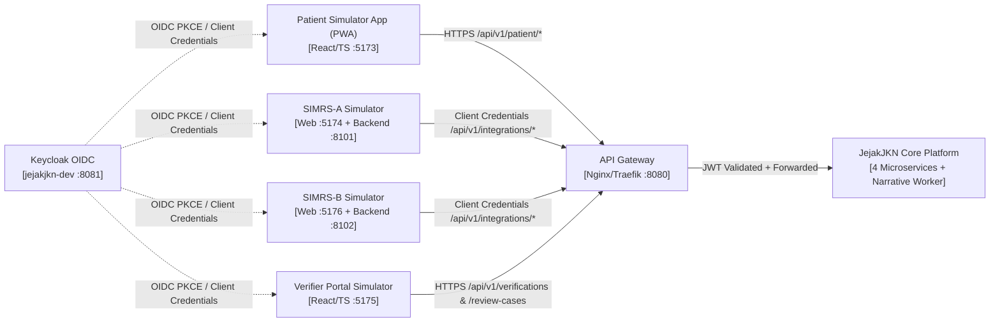

# C4_CONTEXT_AND_CONTAINERS :: v1.0

## 1. SYSTEM_CONTEXT (LEVEL 1)

## 2. CONTAINER_ISOLATION_RULES

1. `simrs-a-backend` (`simrs_a_db`) and `simrs-b-backend` (`simrs_b_db`) store their own clinical records first and dispatch via `adapters/simrs-a` and `adapters/simrs-b` to `api-gateway`.
2. `encounter-service`, `evidence-service`, `verification-service`, and `review-service` communicate synchronously only via `/internal/v1/*` with `internal_service` JWT audience and asynchronously via RabbitMQ topic exchange `jejakjkn.domain.v1`.
3. No service shares database credentials or tables with any other service.
