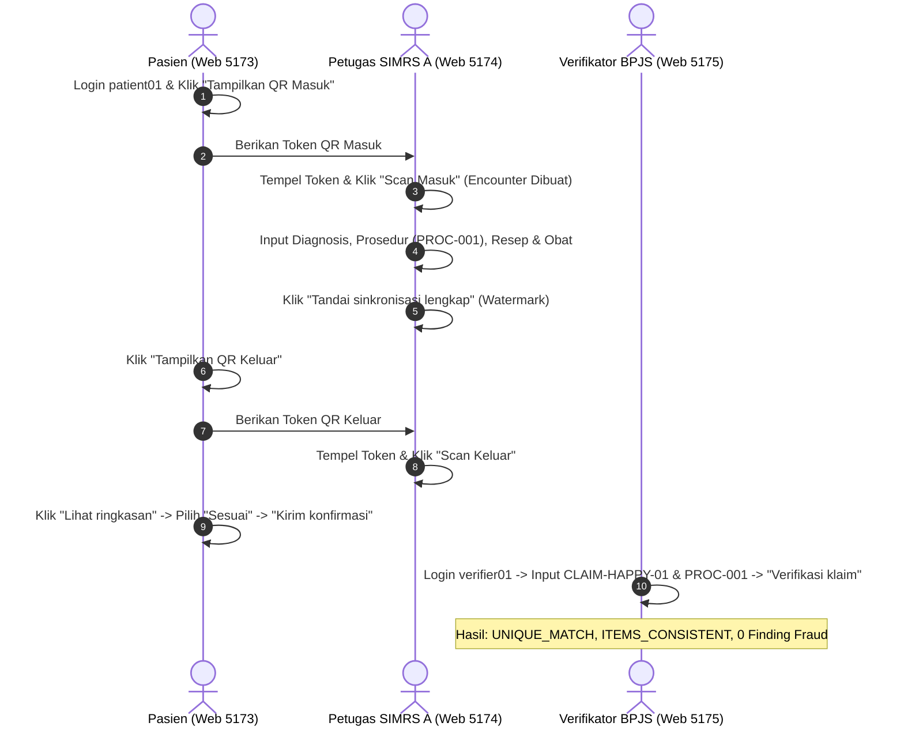

# Panduan Pengujian Manual Menyeluruh (End-to-End Manual Testing Guide) — JejakJKN

Panduan ini disusun untuk pengujian manual antarmuka (UI) dan alur logika sistem JejakJKN. Seluruh skenario mencakup interaksi nyata antar-portal: dari sisi Peserta JKN, Rumah Sakit (SIMRS A & SIMRS B), hingga Verifikator BPJS Kesehatan.

---

## 1. Direktori Portal & Kredensial Login

Seluruh portal web telah aktif dan dapat diakses langsung melalui peramban (browser):

| Portal Web | URL Akses | Peran Pengguna | Username | Password |
| :--- | :--- | :--- | :--- | :--- |
| **Portal Pasien (Mobile JKN Web)** | `http://localhost:5173` | Peserta JKN | `patient01` | `synthetic-patient-01` |
| **SIMRS A Web (Standar FHIR-like)** | `http://localhost:5174` | Petugas RS / DPJP / Farmasi | *(Tanpa login manual — otomatis via adapter)* | *(Otomatis)* |
| **SIMRS B Web (Skema Alternatif)** | `http://localhost:5176` | Petugas RS Mitra Skema Lokal | *(Tanpa login manual — otomatis via adapter)* | *(Otomatis)* |
| **Portal Verifikator BPJS** | `http://localhost:5175` | Verifikator BPJS Kesehatan | `verifier01` | `synthetic-verifier-01` |
| **Keycloak Admin Console** | `http://localhost:8081` | IAM Administrator | `admin` | `admin` |
| **Grafana Monitoring Dashboard** | `http://localhost:3000` | IT Ops / Auditor | `admin` | `admin` |
| **Prometheus Metrics** | `http://localhost:9090` | System Metric Explorer | *(Akses langsung)* | *(Akses langsung)* |

---

## 2. SKENARIO 1: Happy Path — Pelayanan Sah & Auto-Approve (Lengkap End-to-End)

> QR Masuk dan QR Keluar sekarang dapat diproses dari halaman **Pindai QR** SIMRS A/B melalui **Buka kamera**, **Pilih dari galeri**, atau tempel token. Kamera memerlukan `localhost`/HTTPS; gambar lokal harus JPEG, PNG, atau WebP maksimal 10 MiB dan 20 megapiksel. QR langsung diproses setelah terbaca dan tetap memiliki masa berlaku sekitar 60 detik serta hanya dapat dipakai sekali.

**Tujuan:** Menguji siklus lengkap pasien berobat secara sah dengan bukti klinis lengkap, hingga klaim otomatis disetujui tanpa temuan fraud.



### Langkah demi Langkah:

#### Tahap A: Check-In Pasien di Faskes
1. Buka peramban ke **`http://localhost:5173`**.
2. Login dengan akun:
   - **Username:** `patient01`
   - **Password:** `synthetic-patient-01`
3. Pada halaman beranda, klik tombol **`Tampilkan QR Masuk`**.
4. Salin string token panjang yang muncul di kotak **`Token QR untuk simulator`**.
5. Buka tab baru ke **`http://localhost:5174`** (SIMRS A).
6. Tempel (*paste*) token tersebut ke dalam kotak teks **`Token QR`**.
7. Klik tombol **`Scan Masuk`**.
8. **Hasil yang diharapkan:**
   - Muncul notifikasi: *"Scan check-in berhasil."*
   - Kolom **`ID kunjungan`** otomatis terisi UUID baru (simpan UUID ini, contoh: `a1b2c3d4-...`).

#### Tahap B: Pengisian Rekam Medis & Pelayanan Klinis (SIMRS A)
Pastikan kolom **`ID kunjungan`** di `http://localhost:5174` sudah terisi dari tahap sebelumnya.
1. **Input Diagnosis:**
   - **Jenis:** `Diagnosis`
   - **Sistem kode:** `ICD-10`
   - **Kode:** `A09`
   - **Deskripsi:** `Gastroenteritis akut`
   - Klik **`Simpan`**.
2. **Input Tindakan Medis:**
   - **Jenis:** `Tindakan`
   - **Sistem kode:** `LOCAL`
   - **Kode:** `PROC-001`
   - **Deskripsi:** `Konsultasi dokter spesialis`
   - Klik **`Simpan`**.
3. **Input Resep & Penyerahan Obat:**
   - **Jenis:** `Resep obat`
   - **Sistem kode:** `KFA`
   - **Kode:** `OB-PCT500`
   - **Deskripsi:** `Paracetamol 500mg`
   - **Jumlah:** `10`, **Satuan:** `tablet`
   - Klik **`Simpan`**.
   - Ubah Jenis ke **`Obat diserahkan`**, lalu klik **`Simpan`**.
4. **Verifikasi Status Adapter & Finalisasi:**
   - Klik tombol **`Muat status`**.
   - Periksa daftar rekam medis: pastikan kolom status menunjukkan `DELIVERED` (terkirim ke JejakJKN).
   - Klik tombol **`Tandai sinkronisasi lengkap`**.
   - Muncul pesan: *"Watermark sinkronisasi lengkap diantrikan."*

#### Tahap C: Check-Out Pasien & Konfirmasi Layanan
1. Kembali ke tab **`http://localhost:5173`** (Portal Pasien).
2. Klik tombol **`Tampilkan QR Keluar`**.
3. Salin token QR keluar dari kotak teks.
4. Kembali ke tab **`http://localhost:5174`** (SIMRS A), tempel token ke kotak **`Token QR`**, lalu klik **`Scan Keluar`**.
5. Kembali lagi ke **`http://localhost:5173`** (Portal Pasien), klik tombol **`Muat ulang status`**.
6. Pada daftar *Riwayat kunjungan*, kunjungan terbaru akan berstatus `CHECKED_OUT`.
7. Klik tombol **`Lihat ringkasan`**.
8. Muncul daftar tindakan dan obat yang diberikan. Pastikan seluruh item terpilih opsi radio **`Sesuai`**.
9. Klik tombol **`Kirim konfirmasi`**.
10. Muncul pesan konfirmasi: *"Respons CONFIRMED tersimpan."*

#### Tahap D: Pengajuan & Verifikasi Klaim oleh BPJS Kesehatan
1. Buka tab baru ke **`http://localhost:5175`** (Portal Verifikator BPJS).
2. Login dengan akun:
   - **Username:** `verifier01`
   - **Password:** `synthetic-verifier-01`
3. Pada formulir verifikasi, masukkan data berikut:
   - **ID klaim:** `CLAIM-SAH-001`
   - **Nomor peserta:** `SYNTHETIC-10001`
   - **Kode prosedur:** `PROC-001`
4. Klik tombol **`Verifikasi klaim`**.
5. Tunggu 1–2 detik, lalu amati bagian **Empat Dimensi**:
   - **Pencocokan encounter:** `UNIQUE_MATCH` *(Hijau/Valid)*
   - **Rekonsiliasi bukti:** `ITEMS_CONSISTENT` *(Sesuai catatan SIMRS)*
   - **Duplikasi:** `NO_DUPLICATE`
   - **Konfirmasi pasien:** `CONFIRMED`
   - **Temuan aturan:** *"Belum ada temuan."* (Tidak ada pelanggaran fraud)
   - **Keputusan fraud:** `None` / Clean (Auto-Approved).

---

## 3. SKENARIO 2: Deteksi Phantom Billing (Tagihan Fiktif Tanpa Kunjungan)

**Tujuan:** Membuktikan sistem menolak klaim untuk pasien yang tidak memiliki riwayat kunjungan/kehadiran fisik.

1. Buka **`http://localhost:5175`** (Portal Verifikator).
2. Isi formulir dengan data klaim fiktif:
   - **ID klaim:** `CLAIM-PHANTOM-999`
   - **Nomor peserta:** `SYNTHETIC-99999` *(Peserta fiktif / tidak pernah berobat)*
   - **Kode prosedur:** `PROC-001`
3. Klik tombol **`Verifikasi klaim`**.
4. **Hasil yang diharapkan:**
   - **Pencocokan encounter:** `NO_ENCOUNTER_FOUND`
   - **Temuan aturan:**
     - **`R001`** `[HIGH]` `NO_ENCOUNTER` — Pasien tidak terdaftar melakukan kunjungan di RS.
   - **Status:** Klaim ditolak otomatis dan dialihkan ke antrean penelaahan verifikator.

---

## 4. SKENARIO 3: Deteksi Double Billing (Pengajuan Klaim Ganda)

**Tujuan:** Membuktikan sistem mencegah pencairan ganda atas satu nomor kunjungan yang sama.

1. Buka **`http://localhost:5175`** (Portal Verifikator).
2. Masukkan ID klaim baru, tetapi dengan data peserta yang sudah pernah diverifikasi sebelumnya:
   - **ID klaim:** `CLAIM-DOUBLE-TEST-002` *(Atau ID yang sama dengan Skenario 1)*
   - **Nomor peserta:** `SYNTHETIC-10001`
   - **Kode prosedur:** `PROC-001`
3. Klik tombol **`Verifikasi klaim`**.
4. Jika ID klaim sama persis diajukan kembali:
   - Muncul temuan: **`R008`** `[HIGH]` `DUPLICATE_CLAIM_SUBMISSION`
5. Jika ID klaim berbeda namun mengklaim encounter yang sudah pernah diklaim sebelumnya:
   - Muncul temuan: **`R007`** `[HIGH]` `ENCOUNTER_REUSED`
6. **Hasil yang diharapkan:** Sistem memblokir klaim ganda secara seketika (*idempotent protection*).

---

## 5. SKENARIO 4: Deteksi Ghost Procedure / Upcoding (Tindakan Siluman)

**Tujuan:** Membuktikan klaim ditolak jika RS menagihkan tindakan medis berbiaya tinggi yang tidak pernah dicatat oleh dokter di SIMRS.

1. Buka **`http://localhost:5175`** (Portal Verifikator).
2. Masukkan data pasien yang sah dari Skenario 1, tetapi masukkan kode tindakan yang **tidak ada** di rekam medis SIMRS:
   - **ID klaim:** `CLAIM-GHOST-PROC-001`
   - **Nomor peserta:** `SYNTHETIC-10001`
   - **Kode prosedur:** `PROC-HEMODIALISIS-MAHAL` *(Tindakan palsu/upcoding)*
3. Klik tombol **`Verifikasi klaim`**.
4. **Hasil yang diharapkan:**
   - **Rekonsiliasi bukti:** `ITEMS_MISSING`
   - **Temuan aturan:**
     - **`R003`** `[HIGH]` `MISSING_EVIDENCE` — Prosedur yang ditagihkan tidak ditemukan dalam rantai bukti klinis SIMRS.

---

## 6. SKENARIO 5: Deteksi Sanggahan Pasien (Patient Dispute / Layanan Fiktif)

**Tujuan:** Memvalidasi mekanisme perlindungan hak peserta di mana pasien menyanggah layanan/obat yang tercantum pada tagihan.

1. Buka **`http://localhost:5173`** (Portal Pasien).
2. Pada kunjungan yang sudah check-out, klik tombol **`Lihat ringkasan`**.
3. Pada salah satu item obat/tindakan, ubah pilihan radio button dari `Sesuai` menjadi **`Tidak sesuai`**.
4. Klik tombol **`Kirim konfirmasi`**.
5. Muncul pesan konfirmasi: *"Respons DISPUTED tersimpan."*
6. Buka **`http://localhost:5175`** (Portal Verifikator).
7. Lakukan verifikasi ulang klaim terkait (atau klik tombol **`Evaluasi ulang`**).
8. **Hasil yang diharapkan:**
   - **Konfirmasi pasien:** `DISPUTED`
   - Muncul temuan aturan: **`R011`** `[HIGH]` `PATIENT_DISPUTED`
   - Kasus otomatis didorong ke antrean telaah manusia (*Human Review Queue*).

---

## 7. SKENARIO 6: Alur Telaah Manusia & Eksekusi Putusan Verifikator

**Tujuan:** Menguji proses penanganan klaim bermasalah oleh tim auditor/verifikator manusia di BPJS Kesehatan.

1. Buka **`http://localhost:5175`** (Portal Verifikator).
2. Gulir ke bagian **Antrian telaah manusia**.
3. Klik tombol **`Muat antrian`**.
4. Klik pada salah satu kasus klaim yang muncul pada daftar (misal kasus dari Skenario 2, 4, atau 5).
5. Amati rincian yang muncul:
   - **Status Kasus:** `OPEN` / `UNDER_REVIEW`
   - **Narasi Ringkasan Medis (AI Generated Summary):** Penjelasan otomatis kronologi kunjungan dan letak kejanggalan bukti.
6. Pada kotak teks **`Alasan`**, ketikkan pertimbangan verifikator (minimal 10 karakter), misalnya:
   ```text
   Bukti tindakan tidak sesuai dengan SIMRS, butuh konfirmasi dari pihak DPJP rumah sakit.
   ```
7. Klik salah satu tombol putusan resmi verifikator:
   - **`REQUEST_CLARIFICATION`**: Meminta konfirmasi tambahan ke pihak RS.
   - **`ESCALATE`**: Meneruskan temuan ke Tim Anti-Fraud BPJS untuk audit investigatif.
   - **`NO_ACTION`**: Menyatakan klaim dapat diproses jika sanggahan telah diklarifikasi.
   - **`CLOSE_REVIEW`**: Menutup telaah kasus.
8. **Hasil yang diharapkan:** Status kasus berubah sesuai putusan dan riwayat audit tersimpan permanen.

---

## 8. SKENARIO 7: Interoperabilitas SIMRS B (Katalog Skema Lokal)

**Tujuan:** Menguji kemampuan adapter JejakJKN menormalisasi katalog lokal RS yang memiliki format tabel dan kode berbeda (bukan FHIR standar).

1. Buka **`http://localhost:5173`** (Portal Pasien).
2. Klik tombol **`Tampilkan QR Masuk`** dan salin token QR-nya.
3. Buka **`http://localhost:5176`** (SIMRS B Demo).
4. Tempel token ke kotak **`Token QR`**, lalu klik tombol **`Pindai masuk`**.
5. Kolom **`ID kunjungan`** akan terisi UUID encounter baru.
6. Pada bagian **Catatan lokal**, isi data rekam medis format lokal:
   - **Jenis:** `OBAT`
   - **Kode:** `OB-PCT500`
   - **ID rekam:** `RX-LOCAL-999`
   - **Jumlah:** `10`, **Satuan:** `tab`
   - Klik **`Simpan dan antrekan`**.
7. Tambahkan catatan tindakan lokal:
   - **Jenis:** `TINDAKAN`
   - **Kode:** `TND-RAWAT-01`
   - **ID rekam:** `ACT-LOCAL-888`
   - Klik **`Simpan dan antrekan`**.
8. Klik tombol **`Muat status`** -> Amati status catatan lokal `DELIVERED`.
9. Klik tombol **`Sinkronisasi selesai`**.
10. **Hasil yang diharapkan:** JejakJKN berhasil memetakan skema internal SIMRS B ke dalam *canonical schema* JejakJKN tanpa ada kegagalan transformasi data.

---

## 9. SKENARIO 8: Audit Trail & Monitoring Sistem (Prometheus & Grafana)

**Tujuan:** Memverifikasi kesehatan infrastruktur, metrik rekonsiliasi, dan antrean event RabbitMQ.

1. Buka **`http://localhost:3000`** (Grafana Dashboard):
   - **Login:** `admin` / `admin`
   - Periksa panel metrik verifikasi, error rate Gateway, dan latensi pemrosesan.
2. Buka **`http://localhost:9090`** (Prometheus):
   - Masukkan query: `http_requests_total` atau `verification_runs_total`
   - Klik **`Execute`** dan amati grafik lonjakan verifikasi yang telah dieksekusi secara real-time.

---

## 10. Matriks Ringkasan Validasi Manual

| Kasus Uji | Input Kunci | Hasil yang Diharapkan | Status |
| :--- | :--- | :--- | :---: |
| **Skenario 1 (Klaim Sah)** | Pasien hadir QR, SIMRS lengkap, Pasien Konfirmasi | `UNIQUE_MATCH`, `ITEMS_CONSISTENT`, `CONFIRMED` | **PASS** |
| **Skenario 2 (Phantom Billing)** | Peserta fiktif / tanpa check-in QR | `NO_ENCOUNTER_FOUND`, Finding `R001` [HIGH] | **PASS** |
| **Skenario 3 (Double Billing)** | Pengajuan ulang klaim / encounter sama | Finding `R007` & `R008` [HIGH] | **PASS** |
| **Skenario 4 (Ghost Procedure)** | Kode tindakan tidak ada di SIMRS | `ITEMS_MISSING`, Finding `R003` [HIGH] | **PASS** |
| **Skenario 5 (Sanggahan Pasien)** | Pasien memilih "Tidak sesuai" di portal | Konfirmasi `DISPUTED`, Finding `R011` [HIGH] | **PASS** |
| **Skenario 6 (Human Review)** | Buka antrean telaah, isi alasan, submit putusan | Status kasus ter-update (`REQUEST_CLARIFICATION`, dll) | **PASS** |
| **Skenario 7 (SIMRS B Interop)** | Format skema lokal SIMRS B | Normalisasi berhasil, status `DELIVERED` | **PASS** |
